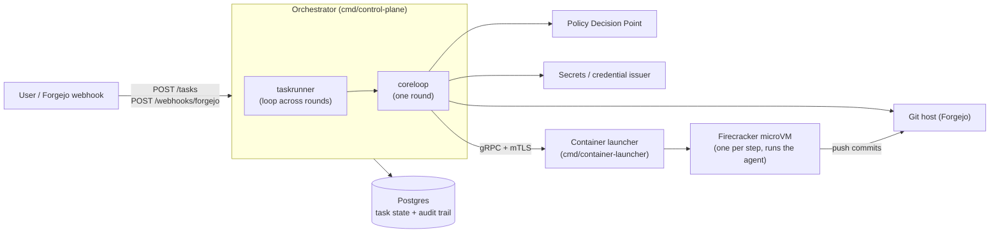

# AiCodAgHar — AI Coding Agent Harness

A governed harness for running AI coding agents against Git repositories. Instead of letting agents act with a developer's own credentials and no record of what they did, the harness puts a control plane in between:

- **Policy-driven** — a Policy Decision Point (PDP) decides, per round, which steps run and whether a human must approve, based on `.harness/*.yaml` config that lives in the target repo.
- **Sandboxed** — every agent step runs in its own short-lived, jailer-wrapped Firecracker microVM with an egress allowlist and a scoped, per-step credential.
- **Reviewed** — work goes through a generate → review → (approve) → publish loop on a pull request, repeated across rounds until it's clean, escalated, or capped.
- **Auditable and resumable** — every policy decision and step outcome is written to a hash-chained Postgres audit trail, and task state is persisted so a task survives a restart.

The problem statement and scope are in [ADR-0](docs/architecture/week1-adr-0-and-capability-map.md).

## Architecture



| Component | What it does | Docs |
|---|---|---|
| **Orchestrator** (`cmd/control-plane`, `internal/control-plane/*`) | HTTP API; drives the round loop (PDP evaluate → create task branch → generate → open review PR → review → aggregate → approval gate → publish); persists task state and audit trail; resumes tasks after restart or approval | [`docs/components/orchestrator.md`](docs/components/orchestrator.md) |
| **Container launcher** (`cmd/container-launcher`, `internal/launcher/*`) | gRPC+mTLS service that runs each step in an isolated Firecracker microVM; secrets in via MMDS, results back over vsock, redacted before leaving | [`docs/components/container-launcher.md`](docs/components/container-launcher.md) |
| **Mocks** (`mocks/pdp-mock`, `mocks/launcher-mock`, `mocks/secrets-mock`) | Local stand-ins for the orchestrator's PDP, launcher and secrets dependencies, wire-compatible with the real contracts — used for local development only | [`docs/local-development.md`](docs/local-development.md) |

The orchestrator (not the sandboxed agent) creates the task branch and review PR; the agent only pushes commits. All external dependencies sit behind interfaces — the Git host in `internal/clients/gitclient`, the PDP, secrets issuer and launcher in `internal/control-plane/clients/*` — so any implementation honoring the contract can be swapped in.

### HTTP API

Full reference in [`docs/components/orchestrator.md` §4](docs/components/orchestrator.md#4-api):

- `POST /tasks` — submit a task; only `target_repo` is required. Returns `202` with a task id.
- `GET /tasks/{id}` — poll a task's state.
- `POST /webhooks/forgejo` — Forgejo events (e.g. approvals that resume a gated task).

> **No authentication or authorization exists yet** — all endpoints are open. Don't expose the control plane beyond a trusted network.

### Repository layout

| Path | Contents |
|---|---|
| `cmd/` | Binaries: `control-plane`, `container-launcher`, `seed` (local stack provisioning) |
| `internal/` | Orchestrator, launcher, dependency clients, config parsing, logging |
| `mocks/` | Local stand-in services |
| `api/` | Launcher protobuf (`api/proto`), generated Go (`api/gen/go`), OpenAPI contracts (`api/openapi`) |
| `schemas/` | JSON Schemas for target-repo `.harness/stages.yaml` and `.harness/policy.yaml` |
| `deploy/` | Docker Compose stack, `.env.example`, SQL migrations |
| `docs/` | Documentation (see below) |

### Documentation map

| Where | What | Status |
|---|---|---|
| [`docs/components/`](docs/components/README.md) | How each component works **today** | Living — trust these when they disagree with older docs |
| [`docs/local-development.md`](docs/local-development.md) | Bringing up and using the local stack | Living |
| [`docs/architecture/`](docs/architecture/) | ADRs — *why* things are the way they are (ADR-0 … ADR-12) | Frozen |
| [`docs/intents/`](docs/intents/) | Requirements behind a body of work | Frozen |
| [`docs/designs/`](docs/designs/) | Design docs per change (`completed/` = landed) | Frozen once landed |
| [`docs/plans/`](docs/plans/) | Implementation plans, PoCs and their results | Historical |
| [`docs/misc/`](docs/misc/) | Personal study notes (e.g. ADR quiz review) | Historical — not a source of truth |

Key ADRs: [execution model (ADR-1)](docs/architecture/week1-adr-1-agent-execution-model.md), [identity & permissions (ADR-2)](docs/architecture/week1-adr-2-agent-identity-and-permission-model.md), [policy enforcement (ADR-3)](docs/architecture/week1-adr-3-policy-enforcement-layer.md), [sandboxing (ADR-4)](docs/architecture/week1-adr-4-blast-radius-and-sandboxing.md), [audit trail (ADR-5)](docs/architecture/week1-adr-5-observability-and-audit-trail.md), [multi-agent review workflow (ADR-7)](docs/architecture/week1-adr-7-multi-agent-review-workflow.md), [orchestrator execution engine (ADR-11)](docs/architecture/week3-adr-11-orchestrator-execution-engine.md).

## Getting started

### Prerequisites

- Go and `buf` — versions are pinned in `.mise.toml`; `mise install` installs both
- Docker + Docker Compose
- `openssl` (generates the dev mTLS certs)

### Build and unit-test

```sh
make build    # go build ./...
make test     # unit tests (no build tags, no external services)
```

### Run the local stack

The local stack runs the real orchestrator against Forgejo and Postgres, with the PDP, secrets issuer and launcher filled in by the mocks:

```sh
cp deploy/.env.example deploy/.env   # defaults are fine for local dev
make compose-up                      # Forgejo + Postgres + mocks + control-plane
make bootstrap-admin                 # mint a Forgejo admin token
make migrate                         # apply deploy/migrations/*.sql
make seed                            # bot accounts + sample config repos
```

Then:

- Orchestrator API: `http://localhost:8080`
- Forgejo: `http://localhost:3001` (note: **3001**, not 3000) — login `forgejo-admin` / `changeme-local-only`

Submit a task and poll it:

```sh
curl -s -X POST http://localhost:8080/tasks \
  -H "Content-Type: application/json" \
  -d '{"target_repo": "forgejo-admin/sample-repo", "description": "Describe the change to implement"}'
# → 202 with a task id; then:
curl -s http://localhost:8080/tasks/<task_id>
```

Tear down with `make compose-down`.

See **[`docs/local-development.md`](docs/local-development.md)** for the full guide: services and ports, rebuilding images, the high-risk / human-approval webhook flow, checking the audit trail in Postgres, and troubleshooting.

The real `container-launcher` needs Linux with `/dev/kvm`, root, and Firecracker/jailer installed, so it doesn't run in this stack; see [`docs/components/container-launcher.md`](docs/components/container-launcher.md).

### Tests against live services

| Command | Needs |
|---|---|
| `make test-integration` | Local stack up, `deploy/.env`, mTLS certs |
| `make test-e2e` | Full local stack, seeded |
| `make test-launcher-kvm` | Linux + `/dev/kvm` + root + real jailer/firecracker (the make target only prechecks `/dev/kvm` access; without root the test fails later at egress setup) |

## Configuring a target repo

A repo the harness works on carries its own config under `.harness/`:

| File | Purpose |
|---|---|
| `.harness/stages.yaml` | The steps to run (agent stages or deterministic commands), their phase, bot account, and when they apply |
| `.harness/policy.yaml` | Policy inputs for the PDP: risk-tier overrides, which steps need human approval at which tier, quotas |
| `.harness/APPROVERS` | Forgejo usernames allowed to approve a gated task, one per line |

The two YAML files are validated against [`schemas/`](schemas/) (examples in `schemas/fixtures/`). `APPROVERS` has no schema; it is parsed by hand in `internal/config/approvers.go`.
