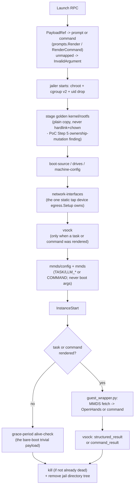

# ContainerLauncher — developer guide

| | |
|---|---|
| **Status** | Living document — describes the current implementation; update it in the same change that makes it stale (see [`docs/components/README.md`](README.md)) |
| **Component** | `cmd/container-launcher` and the `internal/launcher/*` packages it's built from |
| **Design docs** | [`container-launcher-design.md`](../designs/completed/container-launcher-design.md) (lean v1 — implementation sequence §16: all eight steps landed) |
| **Related ADRs** | [ADR-4](../architecture/week1-adr-4-blast-radius-and-sandboxing.md) (isolation/kill-switch/egress requirements this implements), [ADR-10](../architecture/week2-adr-10-microvm-launch-and-lifecycle-mechanics.md) (jailer/MMDS/vsock/egress mechanics), [ADR-8](../architecture/week1-adr-8-coding-agent-runtime-selection.md) (OpenHands headless invocation) |
| **Related plans** | [Firecracker MicroVM Launch PoC](../plans/firecracker-microvm-launch-poc.md) — the hands-on validation this implementation reuses directly rather than re-deriving |
| **Running it locally** | `mocks/launcher-mock` is the default local-dev backend ([`docs/local-development.md`](../local-development.md)); this document covers the real `cmd/container-launcher` binary, which needs `/dev/kvm` + root and can't run in that stack |

## 1. What it is

`ContainerLauncherService`'s production implementation: a gRPC+mTLS server, wire-compatible with `mocks/launcher-mock`, that runs each step invocation inside its own jailer-wrapped Firecracker microVM — real hardware-enforced isolation, not a container and not a mock. Per invocation it boots a real guest kernel/rootfs copied from a golden image, injects credentials and task data via Firecracker's MMDS device (never on the boot-time/image surface — ADR-1/ADR-2's requirement), captures the guest's structured result and event log over `vsock` (decoupled from the guest's own network path, so a network-level failure doesn't also blind the host), enforces a single-invocation egress allowlist via a host tap device + forward proxy + nftables rule, and tears the microVM down on completion, timeout, or an explicit `Kill`.

v1 runs **one invocation at a time** — [§8](#8-known-gaps) covers what that trades away.

## 2. Modularity

| Package | Responsibility |
|---|---|
| `cmd/container-launcher` | gRPC+mTLS entrypoint (`main.go`, runs `egress.Setup` once at startup); `launcherServer` (`server.go`) implements the RPC surface, resolves `PayloadRef` to a rendered prompt/command, and tracks in-flight invocations for `Kill`; `firecrackerLauncher` (`launch.go`) is the real `vmLauncher` — boots the jailed microVM and drives it through to a result; `status.go` derives `RunResult.Status` and the fail-closed defaults from a `vsock` result |
| `internal/launcher/jailer` | `jailer` argv/path construction — `--chroot-base-dir`, `--cgroup-version 2` explicit (required on cgroup-v2-only hosts, PoC Step 5 finding) |
| `internal/launcher/fcapi` | Firecracker's own HTTP-over-unix-socket API client: `/boot-source`, `/drives`, `/machine-config`, `/network-interfaces`, `/mmds/config`, `/mmds`, `/vsock`, `/actions` |
| `internal/launcher/mmds` | V2 session-token-required MMDS config/injection on top of `fcapi` — the only mode exposed, since V1 has no guest-side authentication at all |
| `internal/launcher/vsock` | Host-side `vsock` listener, guest event-envelope decoding, and `Redact` — the literal-secret scrub every captured byte stream runs through before it can leave the launcher |
| `internal/launcher/prompts` | `PayloadRef` (== `StepID`, unchanged) → an OpenHands task prompt (`Render`, "openhands-prompt" mode) or a fixed guest shell command (`RenderCommand`, "command" mode) |
| `internal/launcher/egress` | Static, idempotent host-level tap device + nftables rule + forward-proxy setup, run once at launcher startup — not per invocation |
| `internal/launcher/guest` | `guest_wrapper.py` + its systemd unit — the guest-side half of every real invocation; baked into the golden image manually (there's no build automation for this — [§6](#6-running-it)) |

## 3. Lifecycle of one invocation



Every stage before `InstanceStart` fails closed — any error tears the microVM down and `Launch` returns `status: "error"`. Once running, an invocation ends one of four ways (`RunResult.Status`): `completed` (the guest reported a real result), `timed_out` (the launcher's own ceiling fired first), `killed` (an explicit `Kill` RPC pre-empted it — `context.WithCancelCause` distinguishes this from any other cancellation), or `error` (guest crash, or a missing/malformed result). The last three all fail closed — `has_blocking_finding: true` for agent-stage, a synthetic non-zero exit code for deterministic-step — never a false-clean default.

`vsock.Listen` `chown`s the host-side `<uds_path>_<port>` socket file to the jailed process's own uid/gid (`LAUNCHER_JAILER_UID`/`GID`) — the same treatment jailer itself gives `/dev/kvm`/`/dev/net/tun`. Without it the socket file is owned by whoever the launcher process runs as (typically root), and Firecracker's own `connect(2)` to it on the guest's behalf — issued as the unprivileged jailed uid — fails with `EACCES` (`AF_UNIX` connect requires write permission on the target for the connecting process). This doesn't surface as a visible error: the guest's own `vsock_connect()` retries just keep failing and it gives up, which looks host-side like `WaitForResult`'s `Accept()` never firing at all — confirmed against a real KVM boot, not theoretical.

Teardown removes the invocation's jail directory tree (which covers the API socket, the `vsock` UDS, and the staged image copies — all nested under it) and kills the guest process if it isn't already dead. The tap device is **not** part of per-invocation teardown: [§10](../designs/completed/container-launcher-design.md#10-egress-v1-single-static-setup-not-pooled-automation) of the design treats egress as a static, process-lifetime setup, matching what the PoC itself observed (killing a guest doesn't tear its tap device down).

## 4. API / contracts

Implements `api/proto/launcher/v1/launcher.proto`'s `ContainerLauncherService` — the exact contract `mocks/launcher-mock` implements, so nothing on the orchestrator side changes to point at this binary instead of the mock (`LAUNCHER_ADDR` + the mTLS cert SANs — see [`docs/components/orchestrator.md`](orchestrator.md) §6).

`PayloadRef` → real behavior mapping (`PayloadRef == StepID`, unchanged):

| `StepID` | Mode | Behavior |
|---|---|---|
| `implement` | `openhands-prompt` | Fresh-round or with-prior-findings template, chosen by whether `PRIOR_FINDINGS_JSON` is present |
| `review-with-commit` | `openhands-prompt` | Review template |
| `unit-tests` | `command` | A fixed guest shell command (`internal/launcher/prompts`'s small, closed `StepID`→command map — no path yet from a repo's own `.harness/stages.yaml` to a real per-repo test command, [§8](#8-known-gaps)) |
| *(anything else)* | — | `codes.InvalidArgument` — fails closed, matching the mock's "unknown payload_ref" behavior |

`ExitCode` semantics differ by `StepType`: **agent-stage**'s is the guest wrapper's own exit code (`0` even when `has_blocking_finding: true` — a finding is information, not a launcher failure, matching the mock's existing behavior); **deterministic-step**'s is the guest command's real exit code, propagated directly (`DeterministicStepExecutor` derives `HasFinding` straight from `ExitCode != 0`).

`Kill` cancels a still-running `Launch` call via a per-invocation `context.CancelCauseFunc` tracked while it's in flight; called after the invocation already finished, it returns `Killed: false` (not an error — a legitimate race, not a caller mistake).

## 5. Configuration

Environment variables `cmd/container-launcher/config.go` reads:

| Variable | Required | Purpose |
|---|---|---|
| `TLS_CA_CERT` / `TLS_SERVER_CERT` / `TLS_SERVER_KEY` | Yes | mTLS server identity — unchanged from the mock's contract |
| `LAUNCHER_CHROOT_BASE_DIR` | Yes | jailer's `--chroot-base-dir`; must already exist (jailer canonicalizes it and errors if it doesn't — it does not create the base dir itself). Must be on a real (non-`nodev`) filesystem — `/tmp` is commonly `tmpfs` mounted `nodev` on Linux, which makes jailer's own `/dev/net/tun`/`/dev/kvm` device nodes inside the chroot unusable (`PUT /network-interfaces` fails with "Open tap device failed: ... Permission denied" even though ownership/mode are correct); confirmed on this host (`findmnt -T /tmp` shows `nodev`). Must also be short: this path, joined with `firecracker/<invocation-id>/root/run/firecracker.socket`, is the real host-side Unix domain socket address (unlike the jailed process's own view, which only ever sees the tiny in-chroot path) and Linux caps `sockaddr_un.sun_path` at 108 bytes total — `jailer.Config.SocketPath` fails fast with a clear error if this would be exceeded, but keeping `LAUNCHER_CHROOT_BASE_DIR` under ~40 characters avoids it entirely even with a long (e.g. UUID) invocation id |
| `LAUNCHER_IMAGE_ROOT` | Yes | Directory holding the golden `vmlinux` kernel and `rootfs.ext4` — copied (never hardlinked) into each invocation's jail |
| `LAUNCHER_JAILER_BINARY` / `LAUNCHER_FIRECRACKER_BINARY` | Yes | Paths to the `jailer`/`firecracker` binaries (v1.16.1 x86_64 is what the PoC validated) |
| `ADDR` | No (default `:9443`) | gRPC listen address, matching the mock |
| `LAUNCHER_JAILER_UID` / `LAUNCHER_JAILER_GID` | No (default `123150`/`123150`) | The dedicated non-root uid/gid jailer drops privileges to, and the uid the static tap device is created for ([`internal/launcher/egress`](#2-modularity)) |
| `LAUNCHER_DEFAULT_TIMEOUT_SECONDS` | No (default `1800`) | Hard ceiling applied whenever `LaunchRequest.TimeoutSeconds <= 0` — true of both executors today; a positive caller-supplied value overrides it |
| `LAUNCHER_LLM_API_KEY` / `LAUNCHER_LLM_MODEL` | No | The coding agent's own LLM credentials — platform-level, not per-invocation (unlike `FORGEJO_TOKEN`, which arrives per-invocation in `LaunchRequest.Env`); only merged into MMDS for agent-stage invocations, so a deployment that only ever runs deterministic-step invocations doesn't need them |

A missing required var makes the process `log.Fatalf` immediately, same fail-fast convention as `cmd/control-plane`.

`internal/launcher/egress.DefaultConfig` fixes the tap device name/addressing (`tap0` at `172.16.0.1/30`, guest at `172.16.0.2/30`), the guest subnet the proxy allows (`172.16.0.0/24`), and the nftables table name — all hardcoded, matching the PoC's own validated values exactly rather than exposed as new configuration (design §10 frames this as a fixed, reused-as-is setup).

## 6. Running it

Needs `/dev/kvm`, root (jailer requires it to set up the chroot/cgroup/uid-drop before exec'ing Firecracker), and host-level tap/nftables access — it cannot run in the existing mock `docker-compose` stack (`deploy/docker-compose.yml` stays mock-only, portable to macOS and hosted CI). Design §13 recommends a separate `deploy/docker-compose.real-launcher.yml` overlay (`privileged: true`, `/dev/kvm` device-mapped, `network_mode: host`) or an equivalent host-level systemd unit; **neither is built yet** — see [§8](#8-known-gaps).

Two things this repo does not automate:

- **Golden image baking.** `internal/launcher/guest/guest_wrapper.py` and `guest-wrapper.service` must be manually copied into the golden rootfs image and the systemd unit enabled (patch the PoC's `customize-rootfs.sh` to `cp` them in before `mkfs.ext4 -d`, then `chroot ... systemctl enable guest-wrapper.service`) — the golden-image build/update pipeline itself is out of scope for the design.
- **The guest's own static network config.** `guest_wrapper.py` assumes `eth0` already has `172.16.0.2/30` configured by the image's own boot-time network setup, matching the PoC's image exactly (there's no DHCP server on the tap side to assign one dynamically).

Once those exist and the env vars in [§5](#5-configuration) point at them:

```sh
go build -o container-launcher ./cmd/container-launcher
sudo ./container-launcher   # jailer needs root
```

## 7. Testing

| Layer | Needs live deps? | Command | What it proves |
|---|---|---|---|
| Unit | No | `go test ./...` | `fcapi` against a fake HTTP-over-UDS server; `PayloadRef`→prompt/command mapping; `RunResult.Status` derivation and fail-closed defaults; instant-exit-0 detection; redaction; `resolveTimeout`/`statusForCancellation`; `egress`'s command-building and proxy-config idempotency logic; basic teardown |
| Integration (real KVM) | Yes — `/dev/kvm` + root | `make test-launcher-kvm` | A real jailed Firecracker microVM boots end-to-end through this package's own code (jailer/fcapi/mmds/vsock/egress) with a trivial bare-boot payload, called in-process against the real `*launcherServer` — proves the mechanics work together for real, not just against fakes |
| E2E (real KVM + real OpenHands + real Forgejo) | Yes | *(not built — [§8](#8-known-gaps))* | One real OpenHands agent-stage invocation producing a real PR, driven through the real gRPC server |

`make test-launcher-kvm` fails fast with a clear message if `/dev/kvm` isn't present and readable/writable, before ever invoking `go test` — it's gated to a self-hosted or nested-virtualization-enabled runner, never standard hosted CI or the macOS dev loop. The Go test itself (`cmd/container-launcher/launcher_kvm_test.go`, build-tagged `launcherkvm` so `go test ./...` never picks it up) skips — rather than fails — if `/dev/kvm` or any of the real-binary/golden-image env vars from [§5](#5-configuration) aren't set, so it degrades gracefully when run directly outside `make`.

## 8. Known gaps

Real, needed work the design names as deliberately out of scope for this lean v1 — see [`container-launcher-design.md`](../designs/completed/container-launcher-design.md) §15 for the full list and rationale. The concrete, currently-missing pieces:

- **No concurrency.** v1 runs one invocation at a time: a single fixed `guestCID`, tap device, and jail-relative image copy (per-invocation *full copy*, not the reflink/COW mechanism named as the follow-up design's primary subject). Running two invocations simultaneously today would collide.
- **No orphan-sweep-on-restart, no retry-with-backoff on teardown failure.** Teardown is happy-path-and-explicit-kill only; a launcher crash mid-invocation can leak a jail directory.
- **`GrantedScopes` is accepted but not enforced.** The proxy currently allows a fixed CIDR, not a policy-driven per-invocation allowlist.
- **`make test-launcher-e2e` doesn't exist yet.** Needs a golden image with OpenHands actually installed, real LLM credentials, and a real Forgejo instance — the "one real OpenHands invocation producing a real PR" milestone the design's implementation sequence names, not yet exercised through the real gRPC server end to end in this repo (only proven by hand via the PoC's own console logs).
- **No `deploy/docker-compose.real-launcher.yml` or host-level systemd unit yet** — design §13's recommended deployment shape for running this binary isn't built.
- **Privilege confinement and the gVisor fallback** (ADR-4) are both out of scope — this is a single privileged process, and there is no documented, explicit fallback path.
- **No live KVM validation has been run against this exact Go implementation** — every mechanic (jailer args, MMDS handshake, `vsock` framing, egress rule) is reused directly from the PoC's own hand-driven validation, not re-proven against this code with a real boot.
