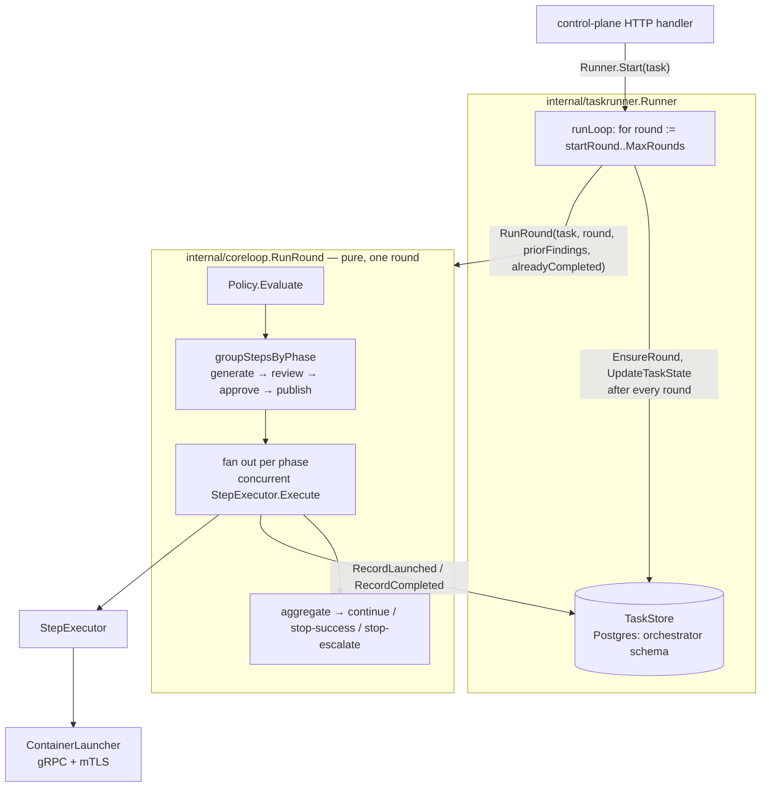

# Orchestrator — developer guide

| | |
|---|---|
| **Status** | Living document — describes the current implementation; update it in the same change that makes it stale (see [`docs/components/README.md`](README.md)) |
| **Component** | `cmd/control-plane` and the `internal/*` packages it's built from |
| **Design docs** | [`orchestrator-design.md`](../designs/orchestrator-design.md) (original MVP), [`full-pipeline-async-approval-design.md`](../designs/next/full-pipeline-async-approval-design.md) (in-flight follow-up — implementation sequence §8: steps 1–2 landed, steps 3–4 not yet) |
| **Related ADRs** | [ADR-7](../architecture/week1-adr-7-multi-agent-review-workflow.md) (core loop), [ADR-9](../architecture/week2-adr-9-orchestrator-foundations.md) (foundations/test-seam interfaces), [ADR-11](../architecture/week3-adr-11-orchestrator-execution-engine.md) (execution engine) |
| **Running it locally** | [`docs/local-development.md`](../local-development.md) — this document covers the orchestrator itself, not the local dev/test stack |

## 1. What it is

The orchestrator is a control-plane that drives a fixed review/automation loop against a Git repo: given a task, it repeatedly asks a policy engine (PDP) what to do this round, dispatches the resulting steps concurrently, and stops when the result is clean, a human needs to approve, or a round cap is hit. Every decision and step outcome is written to an append-only, hash-chained audit trail and to a resumable Postgres-backed task state, so a task survives a control-plane restart at any point in its execution.

It talks to four dependencies — a Git host, a Policy Decision Point (PDP), a secrets/credential issuer, and a sandboxed step launcher — entirely through interfaces (ADR-9's test-seam boundaries; see [§5](#5-contracts)). Any implementation conforming to a dependency's contract can sit behind it with no orchestrator code changes.

## 2. Modularity

| Package | Responsibility |
|---|---|
| `internal/domain` | The nouns everything else operates on. `Task` is a request's immutable config; `TaskState` is its live, persisted status/round/approval fields — split because only `TaskState` changes as a task runs. |
| `internal/coreloop` | `RunRound(ctx, deps, task, round, priorFindings, alreadyCompleted)` — PDP-evaluate → group resolved steps by phase → fan out concurrently → aggregate → return `continue` / `stop-success` / `stop-escalate` for **this round only**. No DB, no loop across rounds — everything it needs comes in through `Dependencies` or its own parameters. |
| `internal/taskrunner` | `Runner.Start` kicks off round 1 in a goroutine and hands back a completion channel; `runLoop` calls `coreloop.RunRound` once per round, persists `TaskState` after each one via `TaskStore`, and stops at the round cap or a terminal outcome. `Runner.Resume` continues a specific task from its next round. `Runner.Reconcile`/`ReconcileTask` — called once at startup — resumes every task left `status=running`, skipping steps already `completed`, resolving ones still `launched` against the launcher, and escalating (not guessing) if one can't be resolved. |
| `internal/executor` | `Registry` is a closed map from step `type` (`agent-stage` \| `deterministic-step`) to a `StepExecutor`. Both executors mint a scoped credential, dispatch through `ContainerLauncher`, extract logs, and return a `domain.StepRun`. |
| `internal/clients/*` | One Go interface + one production implementation per dependency boundary: `gitclient` (`GitHostClient`), `policyclient` (`PolicyClient`), `secretsclient` (`SecretsClient`), `launcherclient` (`ContainerLauncher`). `gitclient` also exposes provisioning-only methods on its concrete `*Client` (repo/user/token bootstrapping), deliberately outside the `GitHostClient` interface — the orchestrator's own runtime never calls them. |
| `internal/audit` | `AuditWriter` interface; `PostgresWriter` writes `audit.invocation_audit`, one hash-chained row per PDP decision / step / task outcome. |
| `internal/approval` | `ApprovalVerifier` interface; `NoopApprovalVerifier` always returns `Approved: false` — the real Forgejo issue/label/webhook-HMAC flow is [design §4.4](../designs/next/full-pipeline-async-approval-design.md), not yet built. |
| `internal/config` | Parses and JSON-Schema-validates `.harness/stages.yaml` / `.harness/policy.yaml`. |

## 3. Execution model: `coreloop` vs. `taskrunner`

This split is the most important — and most recently changed — architectural boundary, so it's worth being explicit about who owns what:



- **`coreloop.RunRound` is a pure, single-round function.** Given `Dependencies` (the same `PolicyClient`/`ApprovalVerifier`/`Executors`/`Audit` every round needs) plus the round number and the previous round's findings, it always does the same thing: evaluate policy, group resolved steps into the fixed `generate → review → approve → publish` phase order (`approve` currently fails closed — no PDP decision can produce it until design §4.4 lands), dispatch each non-empty phase group concurrently, and aggregate. It has no idea what round it's on relative to any cap, and no idea whether this is a fresh task or a resumed one.
- **`taskrunner.Runner` owns everything RunRound doesn't**: the loop across rounds up to `coreloop.MaxRounds`, persisting `TaskState` (`status`, `current_round`, `prior_findings`, ...) after every round, writing the final "task-outcome" audit row, and resuming a task from wherever it left off.
- **Crash recovery is per-step, not just per-round.** `coreloop.Dependencies.Recorder` (a narrow `StepRunRecorder`, backed by `TaskStore` when wired via `taskrunner.NewRunner`) is called by `fanOut` immediately before and after dispatching each step — so a `step_runs` row exists (`status=launched`) from the moment a step is dispatched, updated to `completed`/`failed` once it resolves. `RunRound`'s `alreadyCompleted` parameter is how a caller (only `Reconcile` uses this today) tells it to skip re-dispatching steps a prior, interrupted attempt already finished.
- **There is no launcher "get status by invocation ID" RPC.** Reconciling a still-`launched` step reuses `ContainerLauncher.ExtractLogs` (documented as "independently callable, decoupled from Launch"). This recovers an agent-stage step's finding correctly; a resolved deterministic-step's `HasFinding` is approximated as `false` since `ExtractLogs`' response carries no exit code — a known, deliberate simplification against today's launcher implementation.
- **`waiting_approval` is reserved but not yet reachable.** The `orchestrator.tasks.status` column and `TaskStatusWaitingApproval` constant exist; nothing produces that state yet, since the `approve` phase still fails closed and `require_human_approval` is still the old synchronous, non-pausing check. Design §4.4 changes this.

## 4. API

One endpoint today, still synchronous (design §4.3 will flip this to `202` + `GET /tasks/{id}`):

```
POST /tasks
```

Request body:

```json
{
  "target_repo": "owner/repo",
  "branch": "feature-branch",
  "base_branch": "main",
  "task_type": "pr-review-round",
  "risk_tier": "low",
  "triggering_principal": "manual-test",
  "bot_account": "requesting-account",
  "pr_title": "optional",
  "pr_body": "optional",
  "task_id": "optional — generated if omitted"
}
```

`target_repo`, `branch`, and `task_type` are required. The handler opens/reuses the review PR (`CreateOrUpdatePR`) before starting the task, then calls `taskrunner.Runner.Start` and blocks on its completion channel until the task reaches a terminal outcome.

Response (`200`):

```json
{
  "task_id": "task-...",
  "pr_number": 1,
  "outcome": "stop-success",
  "rounds_run": 1,
  "reason": "",
  "step_runs": [
    {
      "round": 1, "step_id": "review-with-commit", "step_type": "agent-stage",
      "invocation_id": "...", "blocking": true, "exit_code": 0,
      "has_finding": false, "structured_result": {"has_blocking_finding": false}
    }
  ]
}
```

`outcome` is one of `stop-success` / `stop-escalate` (`coreloop.Outcome`, hyphenated). Errors: `400` (bad request body), `502` (couldn't open the PR), `500` (infra failure — a dependency unreachable, or the completion channel returned `Result.Err`), `504` (the request's own context was cancelled before the task finished).

## 5. Contracts

The orchestrator's own dependency contracts — each is a versioned artifact, reviewable independently of whatever sits behind it:

| Dependency | Contract | Consumed via |
|---|---|---|
| Git host | No separate spec — `internal/clients/gitclient.GitHostClient` wraps `code.gitea.io/sdk/gitea`, which is Forgejo's own contract | `internal/clients/gitclient` |
| Policy Decision Point | AuthZEN + `resolved_steps` extension | `api/openapi/pdp-authzen.yaml` → `internal/clients/policyclient` |
| Secrets / credential issuer | OpenBao-shaped subset | `api/openapi/secrets.yaml` → `internal/clients/secretsclient` |
| Step launcher | gRPC + mTLS | `api/proto/launcher/v1/launcher.proto` → generated into `api/gen/go/launcher/v1/` (`make proto-gen`, buf) → `internal/clients/launcherclient` |

`.harness/stages.yaml` and `.harness/policy.yaml` — the config a task's target repo carries, that the PDP resolves against — are their own contracts too: `schemas/stages.schema.json` / `schemas/policy.schema.json` (+ fixtures), mirrored as Go structs in `internal/config`.

## 6. Configuration

Environment variables `cmd/control-plane/main.go` reads:

| Variable | Required | Purpose |
|---|---|---|
| `FORGEJO_URL` | Yes | Git host base URL |
| `FORGEJO_TOKEN` | Yes | Bot/admin token `GitHostClient` authenticates as |
| `PDP_MOCK_URL` | Yes | `PolicyClient` base URL |
| `SECRETS_MOCK_URL` | Yes | `SecretsClient` base URL |
| `LAUNCHER_ADDR` | Yes | `ContainerLauncher` gRPC address |
| `TLS_CA_CERT`, `TLS_CLIENT_CERT`, `TLS_CLIENT_KEY` | Yes | mTLS client identity for the launcher channel |
| `AUDIT_DB_DSN` | Yes | Postgres DSN for `audit.invocation_audit` (role `orchestrator_audit_writer`) |
| `ORCHESTRATOR_DB_DSN` | Yes | Postgres DSN for `orchestrator.{tasks,rounds,step_runs}` (role `orchestrator_app`) |
| `ADDR` | No (default `:8080`) | HTTP listen address |
| `ORCHESTRATOR_INSTANCE_ID` | No (default `control-plane-dev`) | Carried on every `PolicyRequest` |

A missing required var makes the process `log.Fatalf` immediately (fail-fast, not fail-open). `PDP_MOCK_URL`/`SECRETS_MOCK_URL` are named for what currently sits behind them (see [`docs/local-development.md`](../local-development.md)) — the orchestrator itself only cares that something implementing `PolicyClient`/`SecretsClient` answers there.

## 7. Data model

Two Postgres schemas in the one `orchestrator` database:

**`orchestrator` schema** (role `orchestrator_app`, full CRUD) — live, resumable task state:

| Table | Key columns |
|---|---|
| `tasks` | `id` PK, `type`, `target_repo`, `branch`, `base_branch`, `pr_number`, `triggering_principal`, `bot_account`, `risk_tier`, `status` (`running`\|`waiting_approval`\|`stop_success`\|`stop_escalate`), `current_round`, `approval_issue_number`, `approved_by`, `prior_findings` (jsonb), `reason`, `updated_at` |
| `rounds` | `(task_id, round_number)` PK — exists so `step_runs` has something to FK against |
| `step_runs` | `id` PK, `(task_id, round_number)` FK, `step_id`, `step_type`, `invocation_id` (unique), `blocking`, `status` (`launched`\|`completed`\|`failed`), `exit_code`, `has_finding`, `structured_result` (jsonb, nullable — unknown until the step resolves) |

**`audit` schema** (role `orchestrator_audit_writer`, `SELECT`+`INSERT` only — no `UPDATE`/`DELETE`) — the append-only hash-chained trail: `audit.invocation_audit`, one row per PDP decision (`step_type='pdp-decision'`), per dispatched step (`step_type` = the step's own type), and per task's terminal outcome (`step_type='task-outcome'`). See `internal/audit`'s package doc and `ComputeRowHash`/`VerifyChain` for the hash-chain mechanics.

Migrations: `deploy/migrations/001_roles.sql` → `002_orchestrator_schema.sql` → `003_audit_schema.sql` → `004_task_state.sql`, applied via `make migrate`.

## 8. Running it

`cmd/control-plane` is a standard Go binary, configured entirely by the environment variables in [§6](#6-configuration):

```sh
go build -o control-plane ./cmd/control-plane
./control-plane
```

It also builds into a container via `deploy/docker/control-plane.Dockerfile`. Either way, it expects its four dependencies (Git host, PDP, secrets service, launcher) and both Postgres schemas to already be reachable at the configured URLs/DSNs — it does not start or manage them.

For a complete local stack to develop and test against, see [`docs/local-development.md`](../local-development.md).

## 9. Testing

| Layer | Needs live dependencies? | Command |
|---|---|---|
| Unit | No | `go test ./...` |
| Integration | Yes | `make test-integration` |
| Spike (SDK coverage) | Yes | `make test-spike` |
| E2E smoke | Yes | `make test-e2e` |

Unit tests are the primary spec for `coreloop` (`internal/coreloop/coreloop_test.go` — phase dispatch order, cardinality rules, prior-findings plumbing, the `alreadyCompleted` skip path) and `taskrunner` (`internal/taskrunner/taskrunner_test.go` — round cap, blocking→advisory transitions, task-outcome auditing, and reconciliation across a mix of no-row/`launched`/`completed`/unresolvable `step_runs`), run entirely against `internal/fakes` (one in-memory implementation per dependency interface) — no live dependency needed. See [`docs/local-development.md`](../local-development.md) for what the live-dependency layers need running and how to run them.

## 10. Known gaps

Tracked by [`full-pipeline-async-approval-design.md`](../designs/next/full-pipeline-async-approval-design.md)'s implementation sequence (§8):

- **Async API** (§4.3, step 3) — `POST /tasks` is still synchronous (`200`, blocks until terminal); `GET /tasks/{id}` doesn't exist yet.
- **Real human approval** (§4.4, step 4) — `NoopApprovalVerifier` always denies; no Forgejo issue/label/webhook-HMAC flow; `approve`-phase resolved steps fail closed.
- **No launcher status-query RPC** — reconciliation approximates via `ExtractLogs` ([§3](#3-execution-model-coreloop-vs-taskrunner) above); a real implementation would want a dedicated status call.
- **No real `ContainerLauncher`/jailer/Firecracker implementation, OPA policy engine, or secrets backend yet** — the orchestrator depends on these purely through the contracts in [§5](#5-contracts), so a conforming implementation can be substituted with no orchestrator code changes.
- **No horizontal control-plane scaling** — one process, one `TaskStore` connection pool; `Reconcile` assumes it's the only writer.
