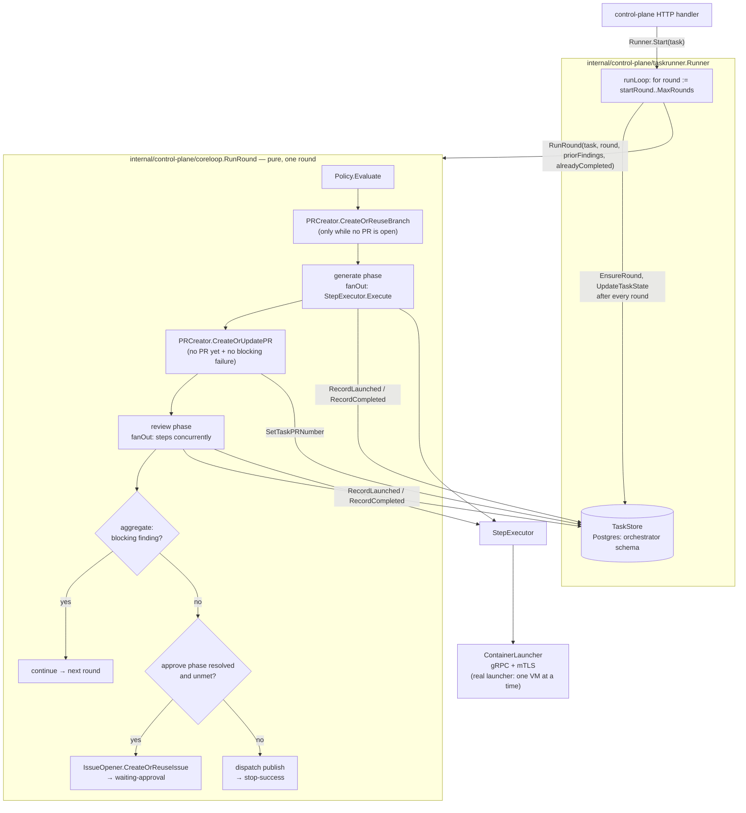

# Orchestrator — developer guide

| | |
|---|---|
| **Status** | Living document — describes the current implementation; update it in the same change that makes it stale (see [`docs/components/README.md`](README.md)) |
| **Component** | `cmd/control-plane` and the `internal/control-plane/*` packages it's built from |
| **Design docs** | [`orchestrator-design.md`](../designs/completed/orchestrator-design.md) (original MVP), [`full-pipeline-async-approval-design.md`](../designs/completed/full-pipeline-async-approval-design.md) (follow-up — implementation sequence §8: all four steps landed), [`task-intent-propagation-design.md`](../designs/completed/task-intent-propagation-design.md) (retires `pr-review-round`, adds the issue-opened task-creation trigger and `Description` propagation), [`pre-generate-branch-creation.md`](../designs/completed/pre-generate-branch-creation.md) (the orchestrator creates the task branch itself, before the generate step dispatches; supersedes [`orchestrator-owned-branch-creation.md`](../designs/completed/orchestrator-owned-branch-creation.md)) |
| **Related ADRs** | [ADR-7](../architecture/week1-adr-7-multi-agent-review-workflow.md) (core loop), [ADR-9](../architecture/week2-adr-9-orchestrator-foundations.md) (foundations/test-seam interfaces), [ADR-11](../architecture/week3-adr-11-orchestrator-execution-engine.md) (execution engine) |
| **Running it locally** | [`docs/local-development.md`](../local-development.md) — this document covers the orchestrator itself, not the local dev/test stack |

## 1. What it is

The orchestrator is a control-plane that drives a fixed review/automation loop against a Git repo: given a task, it repeatedly asks a policy engine (PDP) what to do this round, dispatches the resulting steps phase by phase (steps within a phase concurrently), and stops when the result is clean, a human needs to approve, or a round cap is hit. Every decision and step outcome is written to an append-only, hash-chained audit trail and to a resumable Postgres-backed task state, so a task survives a control-plane restart at any point in its execution.

It talks to four dependencies — a Git host, a Policy Decision Point (PDP), a secrets/credential issuer, and a sandboxed step launcher — entirely through interfaces (ADR-9's test-seam boundaries; see [§5](#5-contracts)). Any implementation conforming to a dependency's contract can sit behind it with no orchestrator code changes.

## 2. Modularity

| Package | Responsibility |
|---|---|
| `internal/control-plane/domain` | The nouns everything else operates on. `Task` is a request's immutable config; `TaskState` is its live, persisted status/round/approval fields — split because only `TaskState` changes as a task runs. |
| `internal/control-plane/coreloop` | `RunRound(ctx, deps, task, round, priorFindings, alreadyCompleted)` — PDP-evaluate → create/reuse the task branch → generate phase → open/reuse the review PR → review phase (phases run in sequence, the steps inside one phase concurrently) → aggregate → if no outstanding blocking findings, gate on `approve` (design §4.4) → dispatch `publish` → return `continue` / `stop-success` / `stop-escalate` / `waiting-approval` for **this round only**. No DB, no loop across rounds — everything it needs comes in through `Dependencies` or its own parameters. |
| `internal/control-plane/taskrunner` | `Runner.Start` kicks off round 1 in a goroutine and hands back a completion channel (kept for tests' benefit — `cmd/control-plane`'s handler no longer reads it, since §4.3 landed); `runLoop` calls `coreloop.RunRound` once per round, persists `TaskState` after each one via `TaskStore`, and stops at the round cap or a terminal outcome. `Runner.GetTaskStatus` composes a task's live state with its full step-run history — `GET /tasks/{id}`'s read path. `Runner.RecordApproval`/`RecordRejection` persist a webhook-verified decision (design §4.4); `Runner.Resume` then re-evaluates the same round it paused on, via `loadAlreadyCompleted`, so already-finished generate/review steps aren't redispatched — only whatever the approve gate was blocking (typically `publish`) actually runs. `Runner.Reconcile`/`ReconcileTask` — called once at startup — resumes every task left `status=running` (a paused `waiting_approval` task is untouched: nothing to reconcile until the webhook arrives), skipping steps already `completed`, resolving ones still `launched` against the launcher, and escalating (not guessing) if one can't be resolved. |
| `internal/control-plane/executor` | `Registry` is a closed map from step `type` (`agent-stage` \| `deterministic-step`) to a `StepExecutor`. Both executors mint a scoped credential, dispatch through `ContainerLauncher`, extract logs, and return a `domain.StepRun`. `InvocationID` derives each step's ID as `<task_id>-r<round>-<step_id>`, using only `[A-Za-z0-9_-]` because the real launcher embeds it in jail paths and rejects anything else. `approve`-phase steps are never dispatched through this registry at all — no container to launch for "wait until a human says yes." |
| `internal/clients/*` | One Go interface + one production implementation per dependency boundary: `gitclient` (`GitHostClient`, including `CreateOrReuseBranch`/`CreateOrUpdatePR` for the task branch and review PR, and `CreateOrReuseIssue`/`ListIssueLabels` for design §4.4), `policyclient` (`PolicyClient`), `secretsclient` (`SecretsClient`, now including `GetWebhookSecret`), `launcherclient` (`ContainerLauncher`). `gitclient` also exposes provisioning-only methods on its concrete `*Client` (repo/user/token bootstrapping), deliberately outside the `GitHostClient` interface — the orchestrator's own runtime never calls them. |
| `internal/control-plane/audit` | `AuditWriter` interface; `PostgresWriter` writes `audit.invocation_audit`, one hash-chained row per PDP decision / step / approval event (`step_type='approval'`) / task outcome. |
| `internal/control-plane/approval` | `ApprovalVerifier` interface. `NoopApprovalVerifier` always returns `Approved: false` — the fail-closed default when no webhook is configured. `RealApprovalVerifier` (design §4.4) just reads back `orchestrator.tasks.approved_by` via its narrow `TaskApprovalReader` — all the actual verification (HMAC signature, `APPROVERS`-file membership, live collaborator-role check) already happened in `cmd/control-plane`'s webhook handler. |
| `internal/logging` | `Setup(component)` installs the process-wide `log/slog` logger from `LOG_LEVEL`/`LOG_FORMAT` ([§6](#6-configuration)). It's shared with `cmd/container-launcher`. Log lines carry `task_id`/`round`/`step_id`/`invocation_id`, so one task can be followed across both processes. |
| `internal/config` | Parses and JSON-Schema-validates `.harness/stages.yaml` / `.harness/policy.yaml`, and (design §4.4) `.harness/APPROVERS` (`ParseApprovers` — one Forgejo username per line, `#`-comments and blank lines ignored). |

## 3. Execution model: `coreloop` vs. `taskrunner`

This split is the most important — and most recently changed — architectural boundary, so it's worth being explicit about who owns what:



- **`coreloop.RunRound` is a pure, single-round function.** Given `Dependencies` (the same `PolicyClient`/`ApprovalVerifier`/`IssueOpener`/`PRCreator`/`PRRecorder`/`Executors`/`Audit` every round needs) plus the round number and the previous round's findings, it always does the same thing: evaluate policy, run the generate phase, then the review phase (each phase's steps concurrently), aggregate — and only if that finds no outstanding blocking finding, check whether this round resolved an `approve`-phase step (design §4.4) and, if so, whether `ApprovalVerifier.VerifyApproval` already reports it satisfied. Satisfied (or absent) → dispatch `publish` → `stop-success`. Unmet → `IssueOpener.CreateOrReuseIssue` and return `waiting-approval` without ever dispatching `publish`. It has no idea what round it's on relative to any cap, and no idea whether this is a fresh task or a resumed one.
- **The orchestrator owns the task branch and the review PR; the sandboxed agent only pushes commits.** Both git-structural side effects stay on the trusted control-plane side of the sandbox boundary. Before the generate phase dispatches, `RunRound` calls `PRCreator.CreateOrReuseBranch(task.Branch, task.BaseBranch)`. The agent clones and pushes to that branch, so it has to exist up front, or the agent falls back to the default branch. This runs every round while `task.PRNumber == 0` and is idempotent, so a failed generate round, a retry or an approve-phase resume just reuses the branch. Once the generate phase finishes without a blocking failure and no PR is open yet, `RunRound` calls `CreateOrUpdatePR` and persists the number via `PRRecorder.SetTaskPRNumber`. That happens *before* the review phase dispatches, because the review prompt needs `task.PRNumber`. A branch or PR error fails the round with an error, which isn't the same as an escalation.
- **Phases run in sequence; the steps inside a phase run concurrently.** `fanOut` starts one goroutine per step and waits for all of them before the next phase. Against `launcher-mock`, a review phase's `review-with-commit` and `unit-tests` really do run in parallel. The real `cmd/container-launcher` runs one microVM at a time, so the second `Launch` RPC queues inside the launcher until the first finishes ([`container-launcher.md`](container-launcher.md) §4). Nothing changes on the orchestrator side for this. The launcher's timeout only starts once a step actually boots, but a phase's wall-clock time is the sum of its steps, not the max. The same goes for steps from different tasks sharing one launcher.
- **`taskrunner.Runner` owns everything RunRound doesn't**: the loop across rounds up to `coreloop.MaxRounds`, persisting `TaskState` (`status`, `current_round`, `prior_findings`, ...) after every round, writing the final "task-outcome" audit row, and resuming a task from wherever it left off — including a paused approve-phase gate, which resumes the *same* round (not the next one) once `RecordApproval` has run.
- **Crash recovery is per-step, not just per-round.** `coreloop.Dependencies.Recorder` (a narrow `StepRunRecorder`, backed by `TaskStore` when wired via `taskrunner.NewRunner`) is called by `fanOut` immediately before and after dispatching each step — so a `step_runs` row exists (`status=launched`) from the moment a step is dispatched, updated to `completed`/`failed` once it resolves. `RunRound`'s `alreadyCompleted` parameter is how a caller tells it to skip re-dispatching steps a prior attempt already finished — `taskrunner.loadAlreadyCompleted` builds it for both `Reconcile`'s crash-recovery path and `Resume`'s post-approval continuation, so a re-evaluated round only actually (re)dispatches what it hasn't already completed.
- **There is no launcher "get status by invocation ID" RPC.** Reconciling a still-`launched` step reuses `ContainerLauncher.ExtractLogs` (documented as "independently callable, decoupled from Launch"). This recovers an agent-stage step's finding correctly; a resolved deterministic-step's `HasFinding` is approximated as `false` since `ExtractLogs`' response carries no exit code — a known, deliberate simplification against today's launcher implementation.
- **A resumed round's PDP re-evaluation gets its own audit row, not a suppressed duplicate.** `coreloop`'s `pdp-decision` invocation ID includes a nanosecond disambiguator specifically because both `Resume` and `ReconcileTask` can legitimately re-evaluate an already-audited round — `invocation_audit`'s unique constraint on `invocation_id` would otherwise reject the second write.
- **A round that errors moves its task to `failed`, with a class and a retryable flag.** If `RunRound` (or any persistence step in `runLoop`) returns an error, `Runner.fail` classifies it with `internal/control-plane/failure` — `dependency` and `infrastructure` are retryable, `platform` and `agent` are terminal; anything unclassified is `platform` — and calls `TaskStore.FailTask`, which in one transaction sets `status=failed`, `error_class`, `retryable`, a bounded (512 B) `reason`, `finished_at` (terminal only) and appends a `task.failed` event. The call sites that wrap errors are the PDP/Git-host/secrets calls in `coreloop` and `executor`, and the launcher's gRPC status. A failed task is never resumed by a restart (`Reconcile` only selects `status=running`); only an operator `POST /admin/tasks/{id}/retry` resumes a retryable one ([§4](#4-api)). If `FailTask` itself can't be written (Postgres down) the task stays `running` and startup reconciliation recovers it. PDP denial, a rejected approval, the round cap and an invalid phase config are **not** failures: they stay `stop_escalate`, carrying a `reason_kind` on `task.finished`.
- **Every state change writes its event in the same transaction.** `PostgresTaskStore` runs the state SQL and the `INSERT INTO task_events` in one `BeginTx` (`CreateTask`, `EnsureRound`, `RecordStepLaunched`, `CompleteStepRun`, `UpdateTaskState`, `FailTask`, `RetryTask`), so a task's timeline can't diverge from its state. Events with no row change (`policy.decided`, `phase.*`, `step.heartbeat`, `step.reconciled`, `round.resumed`) go through `AppendEvents`; `coreloop` reaches that through the nil-safe `Dependencies.Events` (`EventAppender`), keeping `RunRound` free of any store. While a step is in flight `fanOut` appends `step.heartbeat` every `HEARTBEAT_INTERVAL`; a failed heartbeat is logged, not fatal.
- **A launched step that can't be reconciled at startup now fails the task** (retryable, `dependency`/`launcher`) instead of escalating with a `task-outcome` audit row: an unreachable launcher is a fault, not a decision of authority. The eventual real outcome after a retry is audited as usual.
- **`current_round` means "last *completed* round," even while `waiting_approval`.** A round paused on an unmet approve gate hasn't completed, so `current_round` still reflects the round *before* it; `Resume`/`ReconcileTask` both rely on `current_round + 1` to find their way back to the paused round.

## 4. API

Async since design §4.3 landed: `POST /tasks` starts a task and returns immediately; `GET /tasks/{id}` polls its progress.

```
POST /tasks
```

Request body:

```json
{
  "target_repo": "owner/repo",
  "branch": "optional — defaults to task/<task_id>",
  "base_branch": "main",
  "risk_tier": "low",
  "triggering_principal": "manual-test",
  "bot_account": "requesting-account",
  "description": "optional — the task's human-authored intent, propagated as untrusted context into the implement/review prompts (task-intent-propagation design §6-7)",
  "task_id": "optional — generated if omitted"
}
```

Only `target_repo` (`owner/name`) is required. `task_type` is no longer accepted — every task is `new-task`, the sole live type since `pr-review-round`'s retirement (task-intent-propagation design §4). `branch` defaults to `task/<task_id>` when omitted, `base_branch` to `main`, `risk_tier` to `low`. The branch doesn't need to exist yet. The handler **creates neither the branch nor the PR**: it calls `taskrunner.Runner.Start` directly, which persists the task row and kicks off round 1 in a goroutine. `coreloop` then creates (or reuses) the branch off `base_branch` before the generate step dispatches, and opens (or reuses) the review PR once that step completes without a blocking failure ([§3](#3-execution-model-coreloop-vs-taskrunner)). The resulting PR number is persisted back onto the task.

Response (`202`):

```json
{ "task_id": "task-...", "status": "running" }
```

Errors: `400` (bad request body, or `target_repo` missing/not `owner/name`), `500` (`Start` failed to persist the task row).

```
GET /tasks/{id}
```

Response (`200`):

```json
{
  "task_id": "task-...",
  "status": "waiting_approval",
  "current_round": 2,
  "pr_number": 7,
  "approval_issue_number": 12,
  "reason": "optional — outcome reason, or the (bounded) error message of a failed task",
  "accepted_at": "2026-10-11T10:00:00Z",
  "finished_at": "optional — set on stop_success, stop_escalate and a terminal failed",
  "error_class": "optional — platform | infrastructure | dependency | agent, while failed",
  "retryable": true,
  "retry_count": 1,
  "step_runs": [
    {
      "round": 1, "step_id": "review-with-commit", "step_type": "agent-stage",
      "invocation_id": "...", "blocking": true, "status": "completed",
      "exit_code": 0, "has_finding": false, "structured_result": {"has_blocking_finding": false}
    }
  ]
}
```

`status` is `orchestrator.tasks.status`'s own underscore vocabulary (`running` | `waiting_approval` | `stop_success` | `stop_escalate` | `failed`) — not `coreloop.Outcome`'s hyphenated wire vocabulary; `taskrunner` is what translates between the two. `step_runs` spans every round the task has run so far (`TaskStore.ListStepRunsForTask`), each carrying its own `status` (`launched` | `completed` | `failed`) since a poll can land mid-round, before a step resolves. `approval_issue_number` is set once a round's `approve`-phase gate opens an issue (design §4.4). `reason` (omitted when empty) explains a terminal outcome. On a `failed` task it holds the error message, and `error_class`/`retryable`/`retry_count` say how it failed and whether an operator may retry it ([§3](#3-execution-model-coreloop-vs-taskrunner)); `retryable` is only present while `failed`, `error_class` and `finished_at` are omitted when empty. `404` if no such task exists.

```
GET /tasks/{id}/events?type=&since=&until=&after_id=&limit=
```

The task's append-only timeline (`orchestrator.task_events`), in id order: `{"events":[{"id","at","round","step_id","invocation_id","type","payload","trace_id","span_id"}],"next_after_id":N}`. `since`/`until` are RFC 3339; `limit` defaults to 200 (max 1000); pass the response's `next_after_id` as `after_id` for the next page. Event types: `task.accepted`, `task.migrated`, `task.reconciled`, `round.started`, `round.resumed`, `policy.decided`, `phase.started`/`phase.finished`, `step.launched`, `step.heartbeat`, `step.resolved`, `step.reconciled`, `approval.requested`/`granted`/`rejected`, `round.finished`, `task.failed`, `task.retried`, `task.finished` — the vocabulary is open, so consumers ignore types they don't know. `task.finished` carries `wall_ms` and `wait_ms` (human-approval and operator-retry wait); active time is their difference. `400` for a malformed filter, `404` for an unknown task.

**Admin listener** (`ADMIN_ADDR`, default `127.0.0.1:8090` — a separate listener, loopback by default, because there is no authentication yet and one of its routes changes state):

```
GET  /admin/tasks?status=<status>        → [{"task_id","status","since","age_seconds"}]
POST /admin/tasks/{id}/retry             body {"operator":"<name>"} (required, ≤64 bytes)
```

The listing's `since` is the latest `approval.requested` for `waiting_approval`, the latest `task.failed` for `failed`, else `updated_at`. Retry is a compare-and-set: only a task that is `failed`, `retryable` and under `TASK_MAX_RETRIES` is moved back to `running` (`retry_count + 1`, `task.retried` event recording `operator`, remote address and previous class); the handler answers `202` and the task continues in the background like startup reconciliation would, re-entering the same round with its approval state intact. `409` if the task isn't retryable (terminal failure, wrong status, retries exhausted, or a concurrent retry won), `404` if unknown. `operator` is self-declared and is not authentication.

**Access rights** (design §4.3): `GET /tasks/{id}` is meant to require the same access rights as the task's original `POST /tasks`, once any exist — there is no authentication/authorization layer anywhere in `control-plane` today, so both endpoints are unauthenticated in the current implementation.

```
POST /webhooks/forgejo
```

One endpoint, two independent triggers on Forgejo's `issues` webhook event category — dispatched by `action` right after signature verification. Never trusts the delivery's own claims:

1. Verify `X-Forgejo-Signature` (raw hex HMAC-SHA256 over the raw body — confirmed empirically against a real Forgejo instance, not just the design prose) against that repo's secret (`SecretsClient.GetWebhookSecret`). Bad/unprovisioned secret → `403`.
2. `action == "opened"` → task creation (task-intent-propagation design §3), handled separately from the approval flow below: `taskID := "issue-<owner>-<name>-<issue#>"` (deterministic, so a redelivery is a no-op — checked via `Runner.GetTaskStatus` first), the issue's sender must independently hold live `RoleWrite` (`VerifyCollaboratorRole` — the same check §5 below uses, but this is the *only* gate here, since creating a task isn't itself irreversible), and on success a `domain.Task` is built with `Description` set to the issue body and started via `Runner.Start`. Any check failing → `200`, no task created, fail-closed and silent either way.
3. Any other `action` (including `"label_updated"`'s own arrival here before step 4 below) falls through to the approval-decision flow; anything not `"opened"` or `"label_updated"` → `200`, no-op.
4. Look up `orchestrator.tasks WHERE target_repo = ? AND approval_issue_number = ? AND status = 'waiting_approval'` (`Runner.FindWaitingApprovalTask`). No match → `200`, no-op.
5. Independently re-read the issue's current labels (`GitHostClient.ListIssueLabels`) — the payload's own labels are never trusted. Neither `approved` nor `rejected` present → `200`, no-op.
6. Confirm the labeling user (`sender.login`) is listed in `.harness/APPROVERS` at the task's base branch (`GetFileContents` + `config.ParseApprovers`), **and** independently holds live `RoleWrite` (`VerifyCollaboratorRole`) — both required. Either fails → `200`, logged only; the task stays `waiting_approval` (fail-closed, not escalated — a misconfiguration must never manufacture a false approval or a false escalation).
7. All pass: `rejected` → `Runner.RecordRejection` (terminal `stop_escalate`, no resume). `approved` → `Runner.RecordApproval`, then `Runner.Resume` in a new goroutine so the response returns fast.

No request body/response schema beyond what Forgejo itself sends — this isn't a contract the orchestrator publishes, only one it consumes.

## 5. Contracts

The orchestrator's own dependency contracts — each is a versioned artifact, reviewable independently of whatever sits behind it:

| Dependency | Contract | Consumed via |
|---|---|---|
| Git host | No separate spec — `internal/clients/gitclient.GitHostClient` wraps `code.gitea.io/sdk/gitea`, which is Forgejo's own contract | `internal/clients/gitclient` |
| Policy Decision Point | AuthZEN + `resolved_steps` extension | `api/openapi/pdp-authzen.yaml` → `internal/control-plane/clients/policyclient` |
| Secrets / credential issuer | OpenBao-shaped subset, plus a `GetWebhookSecret` read (design §4.4/§7 — a long-lived shared secret, not a minted per-invocation credential, but still sourced from a static pre-provisioned pool) | `api/openapi/secrets.yaml` → `internal/control-plane/clients/secretsclient` |
| Step launcher | gRPC + mTLS | `api/proto/launcher/v1/launcher.proto` → generated into `api/gen/go/launcher/v1/` (`make proto-gen`, buf) → `internal/control-plane/clients/launcherclient` |

`.harness/stages.yaml` and `.harness/policy.yaml` — the config a task's target repo carries, that the PDP resolves against — are their own contracts too: `schemas/stages.schema.json` / `schemas/policy.schema.json` (+ fixtures), mirrored as Go structs in `internal/config`.

## 6. Configuration

Environment variables `cmd/control-plane/main.go` reads:

| Variable | Required | Purpose |
|---|---|---|
| `FORGEJO_URL` | Yes | Git host base URL |
| `FORGEJO_TOKEN` | Yes | Bot/admin token `GitHostClient` authenticates as |
| `PDP_MOCK_URL` | Yes | `PolicyClient` base URL |
| `SECRETS_MOCK_URL` | Yes | `SecretsClient` base URL |
| `LAUNCHER_ADDR` | Yes | `ContainerLauncher` gRPC address |
| `TLS_CA_CERT`, `TLS_CLIENT_CERT`, `TLS_CLIENT_KEY` | Yes | mTLS client identity for the launcher channel |
| `AUDIT_DB_DSN` | Yes | Postgres DSN for `audit.invocation_audit` (role `orchestrator_audit_writer`) |
| `ORCHESTRATOR_DB_DSN` | Yes | Postgres DSN for `orchestrator.{tasks,rounds,step_runs}` (role `orchestrator_app`) |
| `ADDR` | No (default `:8080`) | HTTP listen address |
| `ORCHESTRATOR_INSTANCE_ID` | No (default `control-plane-dev`) | Carried on every `PolicyRequest` |
| `LOG_LEVEL` / `LOG_FORMAT` | No (default `info`/`text`) | `internal/logging`: `debug\|info\|warn\|error` and `text\|json`. `info` logs policy decisions, phase start/finish, step dispatch/finish, branch/PR readiness and task outcomes |
| `ADMIN_ADDR` | No (default `127.0.0.1:8090`) | Admin listener ([§4](#4-api)); compose sets `0.0.0.0:8090` inside the container and publishes it on host loopback only |
| `TASK_MAX_RETRIES` | No (default `3`) | Operator retries allowed per task |
| `HEARTBEAT_INTERVAL` | No (default `5m`) | `step.heartbeat` cadence while a step runs; keep ≤ stuck-task interval / 6. `0` disables |
| `WEBHOOK_APPROVAL_ENABLED` | No (default `false`) | `"true"` wires `approval.RealApprovalVerifier`; otherwise `NoopApprovalVerifier` (fail-closed — an approve-phase gate can open an issue but can never actually clear without a webhook configured) |

A missing required var makes the process `log.Fatalf` immediately (fail-fast, not fail-open). `PDP_MOCK_URL`/`SECRETS_MOCK_URL` are named for what currently sits behind them (see [`docs/local-development.md`](../local-development.md)) — the orchestrator itself only cares that something implementing `PolicyClient`/`SecretsClient` answers there.

## 7. Data model

Two Postgres schemas in the one `orchestrator` database:

**`orchestrator` schema** (role `orchestrator_app`, full CRUD) — live, resumable task state:

| Table | Key columns |
|---|---|
| `tasks` | `id` PK, `type`, `target_repo`, `branch`, `base_branch`, `pr_number`, `triggering_principal`, `bot_account`, `risk_tier`, `status` (`running`\|`waiting_approval`\|`stop_success`\|`stop_escalate`\|`failed`, enforced by a `CHECK`), `current_round`, `approval_issue_number`, `approved_by`, `prior_findings` (jsonb), `reason`, `updated_at`, `created_at` (= accepted), `error_class`, `retryable`, `retry_count`, `finished_at` |
| `rounds` | `(task_id, round_number)` PK — exists so `step_runs` has something to FK against |
| `task_events` | `id` bigserial PK, `task_id` FK, `at` (database clock), `round`, `step_id`, `invocation_id`, `type`, `payload` (jsonb), `trace_id`, `span_id` — append-only: `orchestrator_app` has `INSERT`/`SELECT` only (`UPDATE`/`DELETE` revoked) |
| `step_runs` | `id` PK, `(task_id, round_number)` FK, `step_id`, `step_type`, `invocation_id` (unique), `blocking`, `status` (`launched`\|`completed`\|`failed`), `exit_code`, `has_finding`, `structured_result` (jsonb, nullable — unknown until the step resolves) |

**`audit` schema** (role `orchestrator_audit_writer`, `SELECT`+`INSERT` only — no `UPDATE`/`DELETE`) — the append-only hash-chained trail: `audit.invocation_audit`, one row per PDP decision (`step_type='pdp-decision'`), per dispatched step (`step_type` = the step's own type), per verified approval (`step_type='approval'`, design §4.4), and per task's terminal outcome (`step_type='task-outcome'`; a verified rejection's terminal row carries `approved=false`/`approved_by`/`evidence` too). See `internal/control-plane/audit`'s package doc and `ComputeRowHash`/`VerifyChain` for the hash-chain mechanics.

Migrations: `deploy/migrations/001_roles.sql` → `002_orchestrator_schema.sql` → `003_audit_schema.sql` → `004_task_state.sql` → `005_task_description.sql` → `006_task_events_and_failure.sql`, applied via `make migrate`. `006` adds the failure columns, the status `CHECK` and `task_events`; converts legacy `running` tasks whose `reason` starts `error:` into `failed`/`platform`/retryable; backfills `finished_at`; and writes one `task.migrated` event per task so every task has a timeline. It is idempotent, but stop the control-plane before applying it (a live `runLoop` could be flipped to `failed` mid-flight). No new migration was needed for design §4.4 — every column it needs (`approval_issue_number`, `approved_by`, `reason`; `audit.invocation_audit`'s `approved`/`approved_by`/`evidence`) already existed, reserved but unpopulated, since `004_task_state.sql`.

A repo enabling the approve-phase gate also needs a `.harness/APPROVERS` file (one Forgejo username per line, `#`-comments/blank lines ignored) and a webhook registered against `POST /webhooks/forgejo` with a secret provisioned in `SecretsClient`'s webhook-secret pool — see [`docs/local-development.md`](../local-development.md).

## 8. Running it

`cmd/control-plane` is a standard Go binary, configured entirely by the environment variables in [§6](#6-configuration):

```sh
go build -o control-plane ./cmd/control-plane
./control-plane
```

It also builds into a container via `deploy/docker/control-plane.Dockerfile`. Either way, it expects its four dependencies (Git host, PDP, secrets service, launcher) and both Postgres schemas to already be reachable at the configured URLs/DSNs — it does not start or manage them.

For a complete local stack to develop and test against, see [`docs/local-development.md`](../local-development.md).

## 9. Testing

| Layer | Needs live dependencies? | Command |
|---|---|---|
| Unit | No | `go test ./...` |
| Integration | Yes | `make test-integration` |
| Spike (SDK coverage) | Yes | `make test-spike` |
| E2E smoke | Yes | `make test-e2e` |

Unit tests are the primary spec for `coreloop` (`internal/control-plane/coreloop/coreloop_test.go` — phase dispatch order, cardinality rules, prior-findings plumbing, the `alreadyCompleted` skip path, and the approve-phase gate's pause/skip behavior), `taskrunner` (`internal/control-plane/taskrunner/taskrunner_test.go` — round cap, blocking→advisory transitions, task-outcome auditing, reconciliation across a mix of no-row/`launched`/`completed`/unresolvable `step_runs`, and the full approve/reject pause-resume cycle using `approval.RealApprovalVerifier` against a fake store, not the scripted fake verifier), the failure model (`internal/control-plane/taskrunner/failure_test.go` — the failure-path table, retry compare-and-set and bound, policy outcomes never failing, the event sequence, heartbeats; `postgres_integration_test.go`, tag `integration`, needs `ORCHESTRATOR_DB_DSN` and optionally `ORCHESTRATOR_ADMIN_DB_DSN` to replay migration `006` — covers event atomicity, append-only grants and the concurrent-retry CAS), and the HTTP layer (`cmd/control-plane/handler_test.go` — `POST /tasks` replies `202` without waiting, `GET /tasks/{id}` reflects the eventual terminal outcome and 404s for an unknown task; `cmd/control-plane/webhook_test.go` — signature verification, the full approved/rejected paths, and both APPROVERS-membership and live-collaborator-role fail-closed cases), run entirely against `internal/control-plane/fakes` (one in-memory implementation per dependency interface) — no live dependency needed. See [`docs/local-development.md`](../local-development.md) for what the live-dependency layers need running and how to run them.

`internal/control-plane/e2e/smoke_test.go`'s `TestSmoke_ApprovalWebhookFlow` drives design §4.4 against the real running stack end to end: a real Forgejo label event, a real signed webhook delivery, real independent re-verification. It needs its own fixed scratch repo's webhook secret pre-provisioned in `SECRETS_MOCK_WEBHOOK_POOL_JSON` (single-quoted in `deploy/.env` — `make test-e2e`/`test-integration` source that file with real bash, which strips *unquoted* embedded double quotes, unlike Docker Compose's own `.env` parser) — see `deploy/.env.example`. `TestSmoke_RequireHumanApprovalViaBaselinePolicy` changed meaning under this design: an approve-phase gate now dispatches its round's normal steps and reaches `waiting_approval`, not an immediate zero-launch `stop_escalate`.

## 10. Known gaps

[`full-pipeline-async-approval-design.md`](../designs/completed/full-pipeline-async-approval-design.md)'s implementation sequence (§8) is fully landed. Remaining gaps are pre-existing, not tracked by that design:

- **No launcher status-query RPC** — reconciliation approximates via `ExtractLogs` ([§3](#3-execution-model-coreloop-vs-taskrunner) above); a real implementation would want a dedicated status call.
- **A real `ContainerLauncher` now exists** (`cmd/container-launcher`, jailer/Firecracker-backed — see [`docs/components/container-launcher.md`](container-launcher.md)), but it isn't what this stack runs by default: `deploy/docker-compose.yml` still points `LAUNCHER_ADDR` at `launcher-mock`, since the real binary needs `/dev/kvm`, root, and host-level tap/nftables access that don't fit that compose file's portable, unprivileged shape. Swapping it in is a config change, not an orchestrator code change — the contract in [§5](#5-contracts) is unchanged either way. The manual steps are in [`coreloop-real-launcher-manual-run.md`](../plans/coreloop-real-launcher-manual-run.md). Expect serialized step execution with it ([§3](#3-execution-model-coreloop-vs-taskrunner)).
- **OPA policy engine and secrets backend are still mocked** — the orchestrator depends on both purely through the contracts in [§5](#5-contracts), so a conforming implementation can be substituted with no orchestrator code changes. `secrets-mock`'s webhook-secret pool (§7) is the same kind of static stand-in as its bot-token pool.
- **Observability is partly landed.** Task state/events/failure/retry exist; structured context logging, health endpoints, metrics, tracing and dashboards are still to come (`docs/designs/active/platform-observability-design.md`). Launch errors are classed from the gRPC code alone until the launcher reports per-outcome detail.
- **No horizontal control-plane scaling** — one process, one `TaskStore` connection pool; `Reconcile` assumes it's the only writer.
- **The solo-pilot approver/principal overlap** (ADR-9 §B's named limitation) — nothing stops the task's own `triggering_principal` from also being the one who labels the approval issue; a real second-approver requirement isn't enforced.
