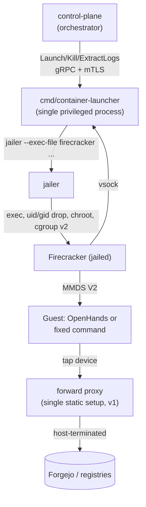

# ContainerLauncher — Production Design (Firecracker/jailer MicroVM Execution)

| | |
|---|---|
| **Status** | Draft — not implemented. Staged in `docs/designs/next/` pending review; move to `docs/designs/` (and update [`docs/components/orchestrator.md`](../../components/orchestrator.md)'s Known-gaps section) once adopted. |
| **Date** | 2026-09-17 |
| **Builds on** | [ADR-4](../../architecture/week1-adr-4-blast-radius-and-sandboxing.md) (Firecracker chosen as default isolation; defense-in-depth stance) · [ADR-8](../../architecture/week1-adr-8-coding-agent-runtime-selection.md) (OpenHands headless invocation, the `--override-with-envs` gotcha) · [ADR-9](../../architecture/week2-adr-9-orchestrator-foundations.md) §C (`ContainerLauncher` is a single-implementation test-seam interface, not a multi-backend abstraction) · [ADR-10](../../architecture/week2-adr-10-microvm-launch-and-lifecycle-mechanics.md) (jailer/MMDS/vsock/egress mechanics this design implements, including the open questions it explicitly deferred here) · [ADR-11](../../architecture/week3-adr-11-orchestrator-execution-engine.md) (agent-stage / deterministic-step closed step-type set) |
| **Scope** | A **lean v1** production `ContainerLauncherService` gRPC server that replaces `mocks/launcher-mock` behind the *unchanged* `api/proto/launcher/v1/launcher.proto` contract — the fastest correct path to one real OpenHands invocation, in a real microVM, producing a real PR, so the rest of the platform (still mocked elsewhere) can be tested end to end. Full production hardening (concurrency, egress-pool automation, teardown automation, kill-switch SLA validation) is explicitly named as [§15](#15-known-gaps--deferred-to-a-follow-up-design)'s follow-up design, not built here. |

## 1. Overview

Today, `mocks/launcher-mock` satisfies `ContainerLauncherService` with in-memory fixture lookups (`mocks/launcher-mock/fixtures.go`) — it performs real Forgejo side effects (commits, comments) using the credential it's handed, but it never actually launches a container, a microVM, or a coding agent. It is the last of the orchestrator's four dependencies (Git host, PDP, secrets, launcher) whose mock doesn't do the thing it stands in for — PDP and secrets can stay mocked indefinitely for testing, since their job really is just "answer a policy question" / "hand back a credential," which their mocks already do faithfully. `ContainerLauncher`'s mock cannot stand in the same way if the goal is to see a real coding agent do real work.

This document designs that real replacement: a gRPC server, wire-compatible with the existing proto, backed by jailer-wrapped Firecracker microVMs (ADR-10) running OpenHands in headless mode (ADR-8) for agent-stage steps, or a fixed guest command for deterministic-step steps.

**What stays exactly as-is** — this design changes nothing about: the proto (`api/proto/launcher/v1/launcher.proto`), the Go `ContainerLauncher` interface and production client (`internal/control-plane/clients/launcherclient`), the executors' call shape (`internal/control-plane/executor/{agent_stage,deterministic_step,credentials}.go`), or the mTLS channel. It only replaces what sits behind `LAUNCHER_ADDR`. `mocks/launcher-mock` is not deleted — it remains the default local-dev backend for anyone without a KVM-capable host.

**What this document resolves** — ADR-10 explicitly deferred four questions to "ContainerLauncher's production implementation." This document is that implementation's design, and answers each, scoped to v1:

| ADR-10 open question | Resolved in | v1 answer |
|---|---|---|
| Per-invocation COW rootfs mechanism (decision point 7) | [§9](#9-per-invocation-isolation-v1-correctness-not-optimization) | Plain full-copy per invocation (correctness first); reflink/COW optimization deferred to follow-up |
| Credential-leakage mitigation stance | [§7](#7-credential-injection-and-log-redaction) | Mechanical literal-byte redaction at extraction time |
| Host-side teardown automation (decision point 6) | [§8](#8-kill-switch-and-timeout-enforcement-v1-scope) | Basic happy-path + explicit-kill teardown; orphan-sweep/reconciler automation deferred |
| Where jailer's root requirement sits in the deployment/privilege model | [§4](#4-privilege-model) | Single privileged gRPC server process (v1); helper-process split named as first hardening candidate |

This is explicitly not an HTTP API design — there's no "Using it" curl-examples section, since it's a gRPC server implementing a contract already documented by [`orchestrator-design.md`](../completed/orchestrator-design.md) §4/§10.

## 2. What already exists — the contract this design implements

`api/proto/launcher/v1/launcher.proto` defines `ContainerLauncherService` (`Launch`/`Kill`/`ExtractLogs`), already implemented client-side by `internal/control-plane/clients/launcherclient.Client` — a production gRPC+mTLS client `cmd/control-plane` already dials at `LAUNCHER_ADDR`. The gap is purely server-side.

| Field | Set by | Mock behavior today | What v1 must define |
|---|---|---|---|
| `PayloadRef` | executors, always `= sc.Step.StepID` | fixture-map key | [§5](#5-payloadref--real-behavior-mapping) |
| `Env["FORGEJO_TOKEN"/"FORGEJO_URL"/"TARGET_REPO"/"BRANCH"/"PR_NUMBER"/"PRIOR_FINDINGS_JSON"]` | `internal/control-plane/executor/credentials.go`'s `launchEnv` | passed straight into fixture git calls | Real MMDS injection ([§7](#7-credential-injection-and-log-redaction)), prompt templating ([§5](#5-payloadref--real-behavior-mapping)) |
| `TimeoutSeconds` | both executors always send `0` | ignored | Launcher-side default ceiling regardless of caller ([§8](#8-kill-switch-and-timeout-enforcement-v1-scope)) |
| `GrantedScopes` | PDP-resolved, passed through | ignored by every fixture | Real egress allowlist source — **deferred to follow-up** ([§10](#10-egress-v1-single-static-setup-not-pooled-automation), [§15](#15-known-gaps--deferred-to-a-follow-up-design)) |
| `RunResult.Status` | — | always `"completed"` or `"error"`, never `timed_out`/`killed` | [§6](#6-response-mapping) |
| `LogBundle.StructuredResultJSON` | — | fixture-hardcoded JSON | [§6](#6-response-mapping) |

Callers (`AgentStageExecutor`, `DeterministicStepExecutor`) send an identical `LaunchRequest` shape for both step types — the only difference is the `StepType` string and how the response is interpreted afterward (agent-stage parses `structured_result_json.has_blocking_finding`; deterministic-step derives `HasFinding` from `exit_code != 0`). Neither caller changes under this design.

Current deployment shape (`deploy/docker-compose.yml`, `deploy/docker/launcher-mock.Dockerfile`, `deploy/gen-certs.sh`): reachable at `LAUNCHER_ADDR` (currently `launcher-mock:9443`), gRPC over mTLS, server env `ADDR`/`TLS_CA_CERT`/`TLS_SERVER_CERT`/`TLS_SERVER_KEY`, cert SANs `DNS:launcher-mock,DNS:localhost,IP:127.0.0.1`. This shape does **not** survive unmodified — see [§13](#13-deployment-and-ci-implications).

## 3. Architecture

| Component | Role | New/existing |
|---|---|---|
| `cmd/container-launcher` | Single privileged gRPC+mTLS server: request validation, jailer/Firecracker invocation, MMDS/vsock wiring, PayloadRef→prompt/command mapping, teardown, response assembly | New |
| `internal/launcher/fcapi` | Thin Go HTTP-over-unix-socket client for Firecracker's own API (`/boot-source`, `/drives`, `/machine-config`, `/actions`, `/mmds*`) — no external Firecracker Go SDK | New |
| `internal/launcher/jailer` | Builds jailer argv, resolves jail paths (`<chroot-base-dir>/<exec-basename>/<id>/root/`) | New |
| `internal/launcher/mmds` | V2 session-token-aware credential/task injection | New |
| `internal/launcher/vsock` | Host-side listener, structured-result parsing, redaction | New |
| `internal/launcher/prompts` | StepID → OpenHands prompt template / deterministic command registry | New |
| `mocks/launcher-mock` | Fixture-driven mock, remains the default local-dev backend | Unchanged |



Note the absence of a separate privileged-helper process — see [§4](#4-privilege-model) for why, and [§15](#15-known-gaps--deferred-to-a-follow-up-design) for when that split becomes worth building.

## 4. Privilege model

ADR-10 explicitly left "where the jailer-requires-root constraint sits in the orchestrator's deployment model" as an open question for this document to answer, since jailer itself must run as root to perform the chroot/cgroup/uid-drop setup before exec'ing Firecracker.

**Decision: the whole `ContainerLauncherService` process runs as a single privileged (root) process.** No separate unprivileged front-end / privileged-helper split for v1.

**Rationale:** the v1 goal is speed to one real, working agent invocation, not a hardened multi-tenant service. A single privileged process is simpler to build, simpler to deploy, and simpler to debug while the mechanics themselves (jailer invocation, MMDS, vsock, prompt mapping) are still being gotten right for the first time. The alternative — an unprivileged gRPC-facing service plus a narrow privileged local helper reached over a Unix socket — is a real defense-in-depth improvement (it confines root to a small, fixed-vocabulary surface, the same logic ADR-10 used to justify jailer over bare Firecracker one layer up), but it is additional design and implementation work that doesn't change whether an agent can run end to end.

**Accepted trade-off, stated plainly:** the mTLS-exposed gRPC surface itself has root for v1. A bug in request parsing, a TLS-library vulnerability, or a malformed `LaunchRequest` field reaching too far into launcher code is a root-level compromise, not a confined one. This is acceptable for a v1 whose consumer is the orchestrator itself (not yet exposed to untrusted multi-tenant traffic), but it is the natural first item for the follow-up hardening design ([§15](#15-known-gaps--deferred-to-a-follow-up-design)) once this needs to run in a less trusted setting.

## 5. `PayloadRef` → real behavior mapping

`PayloadRef` keeps meaning exactly what it means today (`= sc.Step.StepID`) — no caller-side change. A new, launcher-internal registry replaces `fixtures.go`'s fixture map with real behavior, keyed by `StepID`:

| StepID | Mode | Behavior |
|---|---|---|
| `implement` | `openhands-prompt` | Renders `implement.tmpl` (fresh round) or `implement-with-findings.tmpl` (when `PRIOR_FINDINGS_JSON` is present) — same two-branch shape `fixtureImplement` already stubs |
| `review-with-commit` | `openhands-prompt` | Renders `review-with-commit.tmpl` |
| `unit-tests` | `command` | Fixed guest command (e.g. a test-runner invocation) — see gap note below |
| *(unmapped StepID)* | — | Fails closed: `codes.InvalidArgument`, matching the mock's existing "unknown payload_ref" behavior |

**`openhands-prompt` mode:** a Go `text/template` rendered from `LaunchRequest.Env` (`TARGET_REPO`, `BRANCH`, `PR_NUMBER`, `PRIOR_FINDINGS_JSON`), delivered to the guest via MMDS ([§7](#7-credential-injection-and-log-redaction)) as the `task` string the guest wrapper passes to `openhands --headless --json --override-with-envs -t "<task>"`. `PRIOR_FINDINGS_JSON` is quoted into the prompt as untrusted content, never treated as instructions — the same stance `fixtureImplement`'s own commit-message handling already takes.

**`command` mode:** guest boots, clones `TARGET_REPO`@`BRANCH` using the MMDS-delivered credential, runs the fixed command, captures exit code + stdout/stderr over vsock. No OpenHands involved.

**Known gap, not solved here:** `DeterministicStepExecutor` never passes an actual command through `LaunchRequest` today — only `StepID`. There is no path from a repo's `.harness/stages.yaml` to a real per-repo test command yet. v1 hardcodes a small, closed `StepID`→command map in the launcher (the same shape the mock already has — zero interface change required). Threading a real command end-to-end (`stages.yaml` → PDP `resolved_steps` → `LaunchRequest`) needs its own future ADR-11/PDP contract change, listed in [§15](#15-known-gaps--deferred-to-a-follow-up-design).

**v1 uses a single golden image** for every StepID (OpenHands + git + curl + Python/uv, per the PoC's rootfs) — no per-step image variation. A deliberate simplification, not a limitation being papered over.

## 6. Response mapping

**`RunResult.Status` derivation** (replaces the mock's always-`completed`/`error`):

| Status | Condition |
|---|---|
| `completed` | Guest process exited on its own before any timeout; launcher never sent a kill |
| `timed_out` | Launcher's own timer ([§8](#8-kill-switch-and-timeout-enforcement-v1-scope)) fired before the guest signaled completion; launcher issued the SIGKILL |
| `killed` | `Kill` RPC was called explicitly (not a timeout) |
| `error` | jailer/Firecracker failed to start or crashed abnormally; OR the vsock channel never connected within a startup grace window; OR the guest wrapper detected the known OpenHands instant-exit-0 failure signature (below) |

**`ExitCode` semantics**, per step type:
- **agent-stage:** the guest wrapper script's own exit code (0 = OpenHands ran to completion and produced a parseable structured-result file, regardless of `has_blocking_finding`'s value — a finding is normal information, not a launcher-level failure, matching the mock's existing "exit 0 even when blocking" behavior). Non-zero = wrapper/process failure.
- **deterministic-step:** the actual command's exit code, propagated directly — unchanged interpretation from `DeterministicStepExecutor`'s existing `HasFinding: result.ExitCode != 0`.

**Structured-result contract for agent-stage** (this is how the launcher learns whether OpenHands' work produced a blocking finding): the prompt template instructs OpenHands to write a fixed-path JSON file inside the guest workspace (e.g. `/root/result/structured_result.json`, shape `{"has_blocking_finding": bool}`) as its final action. The guest wrapper reads that file after OpenHands exits and emits it as a distinguishable final record on the same vsock event stream; the host-side listener captures it verbatim (post-redaction, [§7](#7-credential-injection-and-log-redaction)) into `ExtractLogsResponse.StructuredResultJson`, unmodified all the way to `AgentStageExecutor`'s existing `json.Unmarshal`.

**Fail-closed default:** if the result file is absent or malformed (OpenHands crashed, or hit the `--override-with-envs` bug below), the launcher does **not** default `has_blocking_finding: false` — it defaults to `true` (an inconclusive run must not look clean) and sets `RunResult.Status = "error"`, not `"completed"`.

**Instant-exit-0 detection:** the PoC found OpenHands headless mode silently ignores `LLM_API_KEY`/`LLM_MODEL` and exits 0 with no work done unless `--override-with-envs` is also passed. The guest wrapper checks OpenHands' own wall-clock runtime and event-log entry count; an exit-0 in under a small threshold (e.g. <5s) with zero tool-use actions in the `--json` log is treated as this known failure signature — reported as `error` with a stderr message naming the suspected cause, never silently reported as `completed`.

## 7. Credential injection and log redaction

**MMDS mechanics** (reused directly from the PoC, already validated, not re-derived): `PUT /mmds/config {version: V2}` before boot; guest performs the session-token handshake at `169.254.169.254`; payload carries `FORGEJO_TOKEN`, `FORGEJO_URL`, `TARGET_REPO`, `BRANCH`/`PR_NUMBER` when present, `LLM_API_KEY`/`LLM_MODEL` (agent-stage only), and the rendered task prompt ([§5](#5-payloadref--real-behavior-mapping)) — never as boot args, kernel cmdline, or process env at the Firecracker/jailer layer.

**vsock mechanics** (reused directly): guest connects `AF_VSOCK` to the host-bound Unix-socket-path convention (`<uds_path>_<port>`); one port carries the `--json` OpenHands event stream, captured host-side.

**Credential-leakage stance (resolves ADR-10's open question, for v1 scope):** structured redaction at extraction time, not a fresh manual audit. The launcher already holds the literal secret values it injected via MMDS (`FORGEJO_TOKEN`, `LLM_API_KEY`), since it received them in `LaunchRequest.Env`. Before returning or persisting any captured bytes (vsock stream, stdout, stderr, structured result), the launcher runs a literal byte-for-byte scrub replacing each known secret value with a fixed marker (e.g. `[REDACTED:FORGEJO_TOKEN]`). This is mechanical and applied every time, covering the full vsock capture — not just the Forgejo-visible output artifacts the PoC manually spot-checked. Symbolic references (`${FORGEJO_TOKEN}` as a shell variable name) are not secret material and are left alone; only literal secret bytes are scrubbed. This scrub runs as the last step before `ExtractLogsResponse` is assembled.

## 8. Kill switch and timeout enforcement (v1 scope)

`TimeoutSeconds` is always sent as `0` by both executors today — this design cannot fix that unilaterally (it's an orchestrator-side change), but the launcher's own behavior stays sane regardless: `timeout_seconds <= 0` is interpreted as "no caller-supplied timeout," but a configurable hard ceiling (`LAUNCHER_DEFAULT_TIMEOUT_SECONDS`, suggested default well above the PoC's observed ~80–86s full-loop wall clock — e.g. 20–30 minutes) still applies, so a wedged microVM can't leak resources forever. A positive caller-supplied value overrides the default.

**Kill mechanics:** direct SIGKILL to the jailer-wrapped Firecracker process, no guest cooperation (ADR-10 decision point 5) — the PoC's measured ~26ms kill-to-gone is the baseline expectation, not a fresh estimate. On expiry or explicit `Kill`, the launcher runs the same **basic teardown** sequence: kill the process if not already dead, remove the API-socket file and console/stdin FIFO, delete the tap device, delete the per-invocation rootfs/workspace copies, remove the jail directory tree.

**What v1 does not build:** an orphan-sweep-on-restart reconciler, retry-with-backoff for transient teardown failures, and measured validation against ADR-4's sub-60s (per-invocation) / sub-5-min (global) kill-switch SLA targets are all real, needed work — but not required to get one agent invocation running, and are deferred to the follow-up design ([§15](#15-known-gaps--deferred-to-a-follow-up-design)). v1's teardown is happy-path-and-explicit-kill only; a launcher crash mid-invocation can leak a tap device or jail directory today, acceptable for a single-operator test environment, not for production.

**Durability caveat** (carried from ADR-10, not re-derived): a hard kill does not guarantee unflushed writes survive (the PoC measured ~13.6s of unsynced workspace-drive appends lost on kill). Currently OpenHands itself owns git commit/push inside the guest, so nothing on the launcher's own side appears to need an explicit fsync point today — flagged for revisit if that ownership ever changes, not solved here.

## 9. Per-invocation isolation (v1: correctness, not optimization)

The PoC's own Steps 7–9 shared one mutated `ubuntu-24.04.ext4` across "fresh" boots and hit a stale-workspace collision in Step 8 that the agent happened to paper over — not safe to rely on, even for v1.

**v1 decision: plain full-copy per invocation.** Before boot, the launcher copies the golden rootfs image and a golden workspace image into the invocation's jail directory as ordinary files. This is correctness-first, not performance-first: a multi-gigabyte copy per launch is acceptable when running one invocation at a time to validate the pipeline, and it requires zero new host subsystem — the result is still a plain raw file, exactly what Firecracker already expects (the PoC used bare `.ext4` files directly).

**Explicitly not built in v1:** the reflink/copy-on-write optimization ADR-10 flagged as "the concrete next implementation task" (decision point 7) is real, necessary work for any deployment running more than one invocation at a time or caring about launch latency at scale — but it is an optimization on top of a mechanism that already works correctly via full-copy. It is named as the primary subject of the follow-up design ([§15](#15-known-gaps--deferred-to-a-follow-up-design)), along with the golden-image directory convention (read-only, versioned) that both the v1 full-copy and the future reflink approach will share.

## 10. Egress (v1: single static setup, not pooled automation)

v1 reuses the PoC's exact validated mechanism as-is, for one invocation at a time: one tap device, a host-terminated forward proxy bound to the tap gateway IP, one static nftables `FORWARD`-chain drop+log rule for that tap device, no NAT/MASQUERADE. This is not new design work — it's the PoC's already-proven Decision E2, reused directly.

**Explicitly deferred to the follow-up design:** concurrent-invocation tap/IP pooling (multiple simultaneous invocations each need their own tap+proxy+nftables-rule instance, allocated and torn down from a pool), and turning the already-existing-but-ignored `GrantedScopes` field into a real per-invocation proxy allowlist (today the PoC's proxy allows a fixed CIDR, not a policy-driven list). v1's egress control still satisfies ADR-4's default-deny requirement for the single invocation it runs — it just isn't safe to run concurrently yet, which v1 doesn't need to.

## 11. Directory structure

```
cmd/
  container-launcher/       gRPC+mTLS server — the real production binary (single privileged process)
internal/launcher/
  fcapi/       Firecracker HTTP-over-unix-socket client
  jailer/      jailer argv/path construction
  mmds/        credential/task injection
  vsock/       log capture + redaction
  prompts/     StepID → OpenHands prompt / command registry
mocks/launcher-mock/   unchanged — default local-dev backend
```

## 12. Security model

| Control (ADR-4) | v1 mechanism | Status |
|---|---|---|
| Hardware-enforced isolation, every invocation | jailer-wrapped Firecracker, `--cgroup-version 2` explicit | Full v1 |
| Credential never touches boot-time/image surface | MMDS V2 injection only ([§7](#7-credential-injection-and-log-redaction)) | Full v1 |
| Log/audit visibility independent of network health | vsock extraction, decoupled from egress path | Full v1 |
| Default-deny egress + logged allowlist | Single static tap/proxy/nftables setup ([§10](#10-egress-v1-single-static-setup-not-pooled-automation)) | v1: correct for one invocation, not concurrency-safe |
| Kill switch | SIGKILL + basic teardown ([§8](#8-kill-switch-and-timeout-enforcement-v1-scope)) | v1: mechanism present, SLA unmeasured |
| Defense-in-depth, assume full compromise | Redaction is mechanical, not agent-trusted; guest never sees plaintext credentials before runtime | Full v1 |
| Privilege confinement (root scoped to a narrow surface) | Not built — single privileged process ([§4](#4-privilege-model)) | Deferred |
| gVisor fallback (documented, explicit, logged) | Not built | Out of scope, see [§15](#15-known-gaps--deferred-to-a-follow-up-design) |

## 13. Deployment and CI implications

This cannot run in the existing `docker-compose` mock stack unmodified — it needs `/dev/kvm` passthrough, root for jailer, and host-level tap/nftables access, none of which fit `launcher-mock.Dockerfile`'s distroless, unprivileged pattern.

**Recommended:** add it to `deploy/docker-compose.yml` behind a compose profile (e.g. `--profile real-launcher`) so default `compose-up` keeps using `launcher-mock`; the real service runs `privileged: true` with `/dev/kvm` device-mapped and `network_mode: host`, documented plainly as "Linux-with-KVM only — will not run on the macOS dev loop or unmodified hosted CI runners." A host-level systemd unit is a reasonable alternative, since a privileged container with host networking is barely different from running on the host directly; either way, `LAUNCHER_ADDR` and the mTLS cert SANs (`deploy/gen-certs.sh`) need to cover the real reachable address, not just the compose-network hostname.

**CI:** standard hosted runners have no KVM. A new, explicitly KVM-gated Make target (e.g. `make test-launcher-kvm`) should fail fast with a clear message if `/dev/kvm` isn't present/writable, run only on a self-hosted or nested-virtualization-enabled runner — a known, hard constraint, not hidden. The bulk of test coverage ([§14](#14-testing-strategy)) should live in the KVM-independent unit layer precisely because of this constraint.

## 14. Testing strategy

| Layer | Needs live deps? | Command | What it proves |
|---|---|---|---|
| Unit | No | `go test ./...` | `fcapi` client against a fake HTTP-over-UDS server; `PayloadRef`→prompt/command mapping; `RunResult.Status` derivation; structured-result parsing + fail-closed default; instant-exit-0 detection; redaction (literal-secret scrub) on synthetic byte streams; basic teardown-sequence ordering |
| Integration (real KVM) | Yes — `/dev/kvm` + root | `make test-launcher-kvm` (new) | A real jailed Firecracker microVM boots end-to-end via the launcher's own gRPC server with a trivial guest payload — proves jailer/MMDS/vsock mechanics through real code, not hand-driven PoC scripts |
| E2E (real KVM + real OpenHands + real Forgejo) | Yes | `make test-launcher-e2e` (new) | One real OpenHands agent-stage invocation producing a real PR, driven entirely through the real gRPC server — the milestone [§16](#16-suggested-implementation-sequence) sequences toward earliest |

## 15. Known gaps — deferred to a follow-up design

The following are real, needed work — deliberately out of scope for this lean v1, and named here as the follow-up design's subject (mirroring how [`orchestrator-design.md`](../completed/orchestrator-design.md)'s MVP was followed by [`full-pipeline-async-approval-design.md`](../completed/full-pipeline-async-approval-design.md)):

- **Per-invocation COW/reflink rootfs provisioning and concurrency** (ADR-10 decision point 7) — v1's plain full-copy works for one invocation at a time; running many concurrently needs the reflink mechanism and a golden-image pooling/versioning story.
- **Full egress-pool automation** — concurrent-invocation tap/IP allocation, and turning `GrantedScopes` into a real per-invocation proxy allowlist.
- **Teardown-automation hardening** — orphan-sweep on launcher restart, retry-with-backoff for transient teardown failures.
- **Kill-switch SLA validation** — a real measurement of kill-to-fully-torn-down latency against ADR-4's sub-60s (per-invocation) / sub-5-min (global) targets.
- **Privilege-model hardening** — the unprivileged-front-end + narrow-privileged-helper split named in [§4](#4-privilege-model), if/when this needs to run against less-trusted input.
- **Deterministic-step real command threading** — `.harness/stages.yaml` → PDP `resolved_steps` → `LaunchRequest`, replacing v1's hardcoded StepID→command map.
- **Golden-image build/update pipeline** — versioning and patch cadence; the PoC's `customize-rootfs.sh` chroot script is the starting point.
- **gVisor fallback** (ADR-4's documented fallback where KVM is unavailable) — explicitly out of scope for this Firecracker-only design.
- **A dedicated launcher status-query RPC** — carried forward from `docs/components/orchestrator.md`'s existing known gap; reconciliation still approximates via `ExtractLogs`.
- **Snapshot/restore** (ADR-10 decision point 8, unchanged) — revisit only if guest boot time is independently measured as a bottleneck.

## 16. Suggested implementation sequence

1. **Bare jailer-wrapped Firecracker boot via the real gRPC server, one hardcoded trivial payload** — drop-in replacement for `launcher-mock` at `LAUNCHER_ADDR`, single golden image, no MMDS/OpenHands yet. Depends on: nothing.
2. **MMDS credential/task injection** ([§7](#7-credential-injection-and-log-redaction)) — real `FORGEJO_TOKEN`/etc. via the V2 handshake. Depends on: 1.
3. **Real OpenHands agent-stage invocation** ([§5](#5-payloadref--real-behavior-mapping), [§6](#6-response-mapping)) — prompt-template mapping, guest wrapper, vsock event stream, structured-result file. **Milestone: one real OpenHands invocation, in a microVM, producing a real PR, via the real gRPC server** — the checkpoint that unblocks full-pipeline end-to-end testing. Depends on: 1, 2.
4. **Status derivation + fail-closed defaults + instant-exit-0 detection + redaction** ([§6](#6-response-mapping), [§7](#7-credential-injection-and-log-redaction)) — formalizes what step 3 hand-wired. Depends on: 3.
5. **Deterministic-step command path** ([§5](#5-payloadref--real-behavior-mapping)) — simpler non-OpenHands guest flow; independently sequenceable alongside 3–4. Depends on: 1, 2.
6. **Basic kill switch + basic teardown** ([§8](#8-kill-switch-and-timeout-enforcement-v1-scope)) — timeout ceiling, `Kill` wiring, happy-path teardown. Depends on: 1.
7. **Basic single-invocation egress** ([§10](#10-egress-v1-single-static-setup-not-pooled-automation)) — the PoC's static tap/proxy/nftables setup, wired into the launcher's own lifecycle. Depends on: 1, 6.
8. **KVM-gated CI target + `docs/components/container-launcher.md`** ([§13](#13-deployment-and-ci-implications), [§14](#14-testing-strategy)) — once landed, move this doc to `docs/designs/` and update `docs/components/orchestrator.md`'s Known-gaps section. Depends on: 1–7.

## 17. Reference

**Environment variables** (`cmd/container-launcher`):

| Variable | Purpose |
|---|---|
| `ADDR` | gRPC listen address (default `:9443`, matching the mock) |
| `TLS_CA_CERT` / `TLS_SERVER_CERT` / `TLS_SERVER_KEY` | mTLS server identity, unchanged from the mock's contract |
| `LAUNCHER_DEFAULT_TIMEOUT_SECONDS` | Hard ceiling applied when the caller sends `TimeoutSeconds <= 0` ([§8](#8-kill-switch-and-timeout-enforcement-v1-scope)) |
| `LAUNCHER_CHROOT_BASE_DIR` | jailer's `--chroot-base-dir` |
| `LAUNCHER_IMAGE_ROOT` | Golden rootfs/workspace image location ([§9](#9-per-invocation-isolation-v1-correctness-not-optimization)) |

**Binaries/versions to reuse directly** (already validated by the PoC, not re-derived): firecracker/jailer v1.16.1 (x86_64), kernel `vmlinux-6.18.44`, Ubuntu 24.04 CI-minimal rootfs built via the PoC's chroot customization script.

**References:** [ADR-4](../../architecture/week1-adr-4-blast-radius-and-sandboxing.md) · [ADR-8](../../architecture/week1-adr-8-coding-agent-runtime-selection.md) · [ADR-9](../../architecture/week2-adr-9-orchestrator-foundations.md) §C · [ADR-10](../../architecture/week2-adr-10-microvm-launch-and-lifecycle-mechanics.md) · [ADR-11](../../architecture/week3-adr-11-orchestrator-execution-engine.md) · [Firecracker MicroVM Launch PoC](../../plans/firecracker-microvm-launch-poc.md) · [OpenHands LocalRuntime Validation](../../plans/openhands-localruntime-validation.md) · [Firecracker PoC study guide](../../plans/firecracker-poc-study-guide.md)
