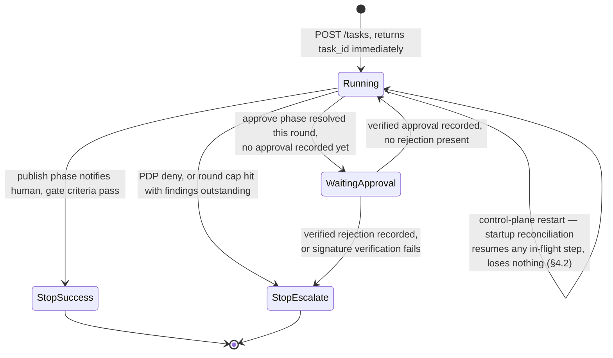
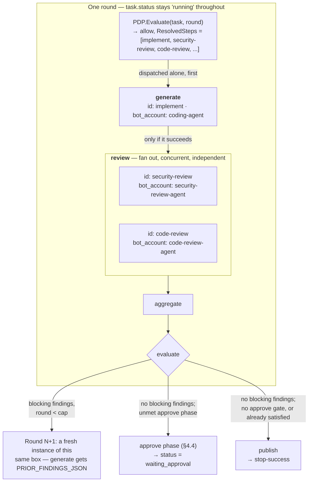
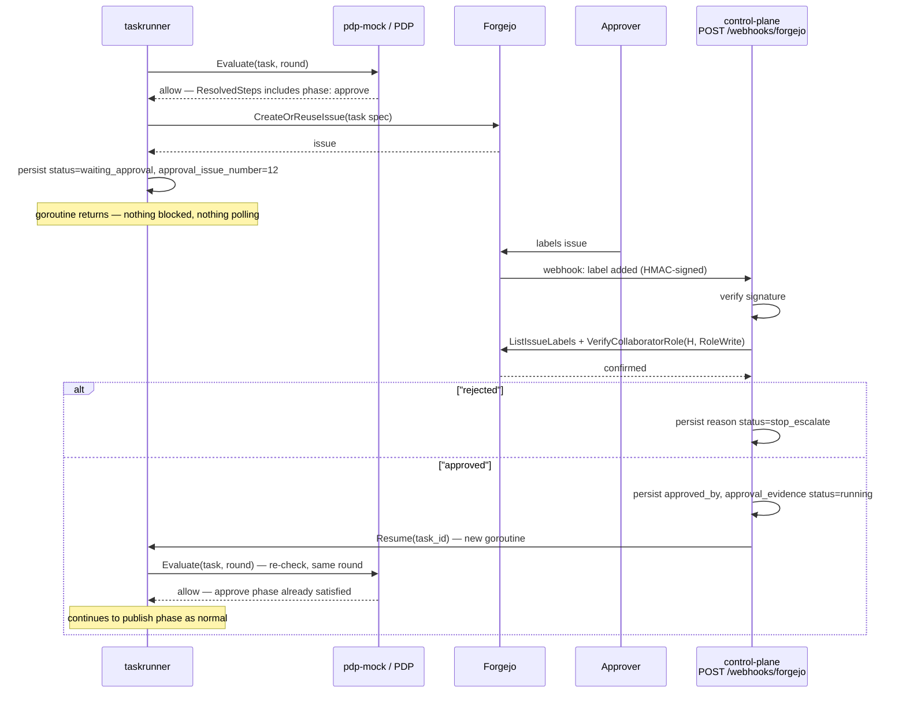

# Follow-up Design: Full-Pipeline Execution, Async Task State, and Real Human Approval

| | |
|---|---|
| **Status** | Draft — not implemented. Staged in `docs/designs/next/` pending review; move to `docs/designs/` (and update [`orchestrator-design.md`](../orchestrator-design.md)) once adopted |
| **Date** | 2026-09-11 |
| **Owner** | kniemiec |
| **Builds on** | [ADR-7](../../architecture/week1-adr-7-multi-agent-review-workflow.md) (core loop), [ADR-9](../../architecture/week2-adr-9-orchestrator-foundations.md) §B (human-approval mechanism) |
| **Extends** | The implemented MVP described in [`orchestrator-design.md`](../orchestrator-design.md) |

## 1. Problem statement

The implemented MVP (Phases 0–6) proves the core-loop mechanics — round cap, concurrent fan-out, blocking-vs-advisory aggregation, hash-chained audit — but simplifies away three things a real "configure once, run to completion, pause only for approval" workflow needs:

1. **No "generate" (coding-agent) stage.** The MVP's round is *fan out → aggregate → evaluate* — nothing writes or fixes code, so a round with a blocking finding has no way to act on it before the next round asks the same question again.
2. **No real human-approval pause/resume.** The MVP's `NoopApprovalVerifier` always returns `Approved: false`, checked once, synchronously, then the task terminates — there is no "wait."
3. **`control-plane` is fully synchronous.** One HTTP request runs a task to a terminal state and returns; there's nowhere for "pause for a human, possibly hours later, then resume" to live.

This document designs the gap between "documented" (ADR-7/ADR-9) and "built."

## 2. Goals / non-goals

**Goals**
- Configure a full stage pipeline once (generate → review → approve → publish); trigger it once; it runs unattended to `stop-success`/`stop-escalate`, pausing only where policy requires a human.
- A real, ADR-9-§B-shaped approval mechanism: issue-based, webhook-verified, resumable.
- Survive a `control-plane` restart at any point in a task's execution, not only while paused on approval — per-step persistence, not only per-round (§4.2).
- Heterogeneous review (e.g. a security-review agent and a code-review agent in the same round) expressible with no dedicated field (§4.1).
- No new infrastructure beyond what's already decided (Forgejo, Postgres).

**Non-goals**
- Horizontal control-plane scaling / a real job queue. A single-process, Postgres-backed resume model is proportionate to current scale.
- Automating the merge/publish *action* for code/PR tasks — `publish` is a real pipeline phase, but for code tasks it always resolves to a human handoff, never an automated merge (§4.6).

## 3. Design overview



Core structural change: task execution moves from one blocking function call to a persisted state machine, stepped round-by-round, that can suspend and be resumed by an external event.

## 4. Detailed design

### 4.1 Stage phases

Every round is built from four fixed phases, always dispatched in this order: **generate → review → approve → publish**. This closed set, in this fixed order, is hardcoded — same spirit as ADR-11's step-type closed set. Which phases appear in a given round, and how many agents run within a phase, is PDP-resolved configuration.

**Contract change**: add a `phase` field to `schemas/stages.schema.json` and `ResolvedStep` (`api/openapi/pdp-authzen.yaml`, `internal/clients/policyclient.ResolvedStep`):

```yaml
- id: implement
  type: agent-stage
  phase: generate             # generate | review | approve | publish, default "review"
  bot_account: coding-agent
  task_type: implement-fix
  blocking: true

- id: security-review
  type: agent-stage
  phase: review
  bot_account: security-review-agent
  task_type: pr-review-round
  blocking: true

- id: code-review
  type: agent-stage
  phase: review
  bot_account: code-review-agent
  task_type: pr-review-round
  blocking: true
```

Cardinality per phase is structural, not a config field — it's just however many resolved steps declare that phase:

- **generate**, **publish** — at most one step per round; a second is a fail-closed config error.
- **review** — zero or many steps, dispatched concurrently; heterogeneity (security-review, code-review, ...) is just separate list entries.
- **approve** — not a step count; needs at least one verified approval and no verified rejection (§4.4).

**`coreloop.Run` change**: group `decision.ResolvedSteps` by `phase`, enforce the cardinality rules above, dispatch phase groups in fixed order, proceeding to the next phase only if the current one's steps all succeed. `generate`/`review`/`publish` stay within ADR-11's `agent-stage | deterministic-step` closed set — this only adds ordering, not a new step type.

**One round's internals** — one `implement` agent in `generate`, then `security-review`/`code-review` fanning out in `review`:



`generate` and `review` both run while `status` is still `running` — nothing pauses between them. The only thing that moves `status` to `waiting_approval` is an unmet `approve` phase; blocking findings at `evaluate` just start another round, still `running`.

**`generate` specifics**: its env additionally carries `PRIOR_FINDINGS_JSON` — the previous round's aggregated findings — for the coding agent to act on. Round 1 omits it. Mocked world: a new `launcher-mock` fixture (`implement-fix`) commits a fix addressing prior findings, or an initial implementation on round 1.

### 4.2 Persisted, resumable task state

Extend the reserved `orchestrator` schema ([`002_orchestrator_schema.sql`](../../../deploy/migrations/002_orchestrator_schema.sql)):

```sql
ALTER TABLE orchestrator.tasks
    ADD COLUMN status text NOT NULL DEFAULT 'running',
        -- running | waiting_approval | stop_success | stop_escalate
    ADD COLUMN current_round integer NOT NULL DEFAULT 0,
    ADD COLUMN approval_issue_number integer,
    ADD COLUMN approved_by text,
    ADD COLUMN prior_findings jsonb,
    ADD COLUMN reason text,
    ADD COLUMN updated_at timestamptz NOT NULL DEFAULT now();
```

`orchestrator.step_runs` starts being written to: one row per `domain.StepRun`, giving `GET /tasks/{id}` (§4.3) and the next round's `generate` phase a durable source for `prior_findings`.

**Row written at launch, not only completion**: `step_runs` gains a `status` column (`launched | completed | failed`); a row is inserted the moment a step is dispatched, then updated in place once it resolves. This is what makes any in-flight step crash-recoverable, not just round boundaries.

**Startup reconciliation**: on `control-plane` startup, scan `orchestrator.tasks WHERE status = 'running'`. For each, inspect the current round's `step_runs`:
- no rows yet for a phase group → dispatch it.
- a row still `launched` → query the launcher for that `Invocation-Id`'s actual status and reconcile before marking `completed`/`failed` (don't blindly relaunch).
- a fully `completed` phase group → advance to the next phase.

**`internal/taskrunner` (new package)**:
- `taskrunner.Start(ctx, task) (taskID, error)` — inserts the `tasks` row, kicks off round 1 in a goroutine, returns immediately.
- `taskrunner.runRound(ctx, taskID)` — loads persisted state, runs one round's phase dispatch, then either persists `current_round++` and loops (no blocking findings, approve phase absent or already satisfied), persists `status = waiting_approval` and returns (approve phase present, not yet approved), or persists a terminal status and returns.
- `taskrunner.Resume(ctx, taskID)` — called by the webhook handler (§4.4) after verification; reloads state and calls `runRound` again.

`coreloop` shrinks to a pure, single-round function (`RunRound(ctx, deps, task, round, priorFindings) (RoundResult, error)`), called once per invocation instead of looping internally. `taskrunner` owns looping, persistence, and pause/resume; `coreloop` still owns the ADR-7 decision logic.

### 4.3 Async API

`POST /tasks` becomes non-blocking:

```
POST /tasks  →  202 Accepted
{ "task_id": "task-...", "status": "running" }
```

New:

```
GET /tasks/{id}  →  200 OK
{
  "task_id": "task-...", "status": "waiting_approval",
  "current_round": 2, "pr_number": 7,
  "approval_issue_number": 12,
  "step_runs": [ ... ]
}
```

**Migration note**: the `200` synchronous body is a breaking change for existing callers, including `internal/e2e`'s smoke tests. §8 sequences the e2e update alongside this change.

**Access rights**: `GET /tasks/{id}` requires the same access rights as the task's original `POST /tasks` — one check, not a separate model per endpoint. `POST /webhooks/forgejo` is different in kind, not just degree: it isn't called on behalf of the task's creator at all, so there's no "inherited" access right to check — its own authenticity comes entirely from §4.4's independent checks (HMAC signature, `APPROVERS`-file membership, live collaborator role). The approver is very often a different principal than whoever created the task.

### 4.4 The `approve` phase and real `ApprovalVerifier`

`approve` is a phase like the other three, but it's never dispatched through `StepExecutor` — there's no container to launch for "wait until a human says yes." PDP resolves a single `phase: approve` entry (or none); it needs no extra fields, since the gate is simply: **at least one verified approval, and no verified rejection.**

**PDP contract simplification**: `policyclient.PolicyDecision.Decision` drops from three values to two (`allow | deny`) — `require_human_approval` folds away. "This round needs a human" is now expressed as a resolved step with `phase: approve` on an ordinary `allow`, the same way "needs a security reviewer" is. `taskrunner` derives `status = waiting_approval` from an `approve` phase with no recorded decision yet; PDP itself no longer signals it directly.

**Approver identity**: each repo's `APPROVERS` file lists Forgejo usernames — the identifier `GitHostClient.VerifyCollaboratorRole` already takes and the webhook's label-added event reports.

**A. `GitHostClient` gains two methods**: `CreateOrReuseIssue(ctx, repo, title, body) (Issue, error)` opens or reuses the approval issue. `ListIssueLabels(ctx, repo, issueNumber) ([]string, error)` independently re-reads the issue's current labels rather than trusting the webhook payload. Reading the `APPROVERS` file needs no new method — `GetFileContents(ctx, repo, path, ref)` already covers it.

**B. `POST /webhooks/forgejo`** — new `control-plane` endpoint, called by Forgejo on labeling events (labels: `approved`, `rejected`):
1. Verify `X-Forgejo-Signature` (HMAC-SHA256) against that repo's configured webhook secret. Bad signature → `403`, stop.
2. Parse the label-added event: repo, issue number, labeling user, which label.
3. Look up `orchestrator.tasks WHERE approval_issue_number = ? AND status = 'waiting_approval'`. No match → `200`, stop.
4. Independently confirm the label is actually present on the issue right now, that `labelingUser` is listed in the repo's `APPROVERS` file (via `GetFileContents`), and `VerifyCollaboratorRole(ctx, repo, labelingUser, RoleWrite)` (the labeler still genuinely has repo access — catches a stale `APPROVERS` entry for someone since removed). All three are required — `APPROVERS` is the authorization list, the collaborator-role check is a live sanity check on it, not a substitute for it.
5. All pass, `rejected` → persist `reason`, flip `status = stop_escalate`. All pass, `approved` → persist `approved_by`/`approval_evidence`, flip `status = running`, dispatch `taskrunner.Resume(ctx, taskID)` in a new goroutine so the webhook response returns fast.
6. Any verification failure → log only; task stays `waiting_approval` (fail-closed, not `stop-escalate`).

**Why no reconciliation job is needed here**: resume is triggered by the webhook arriving, not a poller — a restart while `waiting_approval` loses nothing, since Postgres holds the state and step 3's lookup still finds the task whenever the webhook (re)arrives.

**`ApprovalVerifier`'s real implementation**: `VerifyApproval` just reads `tasks.approved_by` — the actual verification work already happened in the webhook handler. `NoopApprovalVerifier` remains the fail-closed default where no webhook is configured (e.g. local dev).

**Sequence for one paused-then-resumed task:**



### 4.5 What stays as-is

- `internal/executor`, `internal/clients/*` production implementations, the mTLS launcher channel, per-step credential mint/revoke, the hash-chained audit writer, and the aggregate/evaluate logic are untouched — this design only changes what drives `coreloop` and what happens between rounds.
- Existing `coreloop` unit tests adapt lightly (calling `RunRound` once instead of `Run` in a loop).

### 4.6 The `publish` phase is a terminal handoff, not an automated merge

`publish` is a real, PDP-resolved phase (§4.1), but for code/PR tasks it never performs the merge itself — it resolves to a `deterministic-step` that posts a "ready to merge" notification, and the round reaches `stop-success`. The merge stays a human action by design.

For a non-code artifact type where publishing is genuinely automatable, the same phase slot could resolve to a real publishing action instead — a decision for whichever future ADR introduces that artifact type.

## 5. Data model changes (summary)

| Table | Change |
|---|---|
| `orchestrator.tasks` | New columns: `status`, `current_round`, `approval_issue_number`, `approved_by`, `prior_findings`, `reason`, `updated_at` (§4.2, §4.4) |
| `orchestrator.step_runs` | Written at launch time, not only completion; gains `status` (`launched \| completed \| failed`) (§4.2) |
| `audit.invocation_audit` | Unchanged shape; `approved`/`approved_by`/`evidence` fields start being populated for real on resume |

## 6. API contract changes (summary)

| Endpoint | Change |
|---|---|
| `POST /tasks` | `200` synchronous body → `202` + `task_id`, execution continues in background |
| `GET /tasks/{id}` | **New** — status polling, backed by `orchestrator.tasks`/`step_runs` |
| `POST /webhooks/forgejo` | **New** — HMAC-verified label-event receiver; an `approved` label resumes the task, a `rejected` label escalates it |

## 7. Security considerations

- Webhook signature verification is fail-closed (§4.4 step 1/6).
- Webhook secrets are per-repo (safer than one global secret — a leak or rotation on one repo doesn't affect the rest) and are new credentials: reuse the existing `secrets-mock`/pool mechanism (`SECRETS_MOCK_POOL_JSON`) to store and fetch them keyed by repo, the same pattern already used for bot tokens, rather than a new secrets store.
- Collaborator-role re-verification never trusts the webhook payload's own claims.
- `prior_findings` fed into `generate`'s env is untrusted content from the orchestrator's own review stages — prompt framing built on top of it should treat it accordingly, not as a trusted instruction.

## 8. Suggested implementation sequence

1. **Generate stage + phase grouping** (§4.1) — additive, no API/persistence changes. Add the `phase` field, phase-group dispatch in `coreloop`, the `implement-fix` fixture. Testable with today's synchronous API unchanged.
2. **Persisted, per-step-resumable task state + `taskrunner`** (§4.2) — wire up the reserved schema, `step_runs.status`, extract `taskrunner` plus startup reconciliation; keep the API synchronous for now (handler calls `taskrunner.Start` then blocks on a completion channel).
3. **Async API** (§4.3) — flip `POST /tasks` to `202`, add `GET /tasks/{id}`, update `internal/e2e` to poll.
4. **Real `ApprovalVerifier` + webhook + `approve`-phase gate** (§4.4) — depends on 2 and 3.

## 9. Testing strategy for this design

- **Unit**: `taskrunner` pause/resume transitions against fakes.
- **Unit**: startup reconciliation — a task left `running` with a mix of no-row/`launched`/`completed` `step_runs` resumes correctly without double-launching an in-flight step.
- **Integration**: webhook signature verification (valid/invalid HMAC); approval by a non-collaborator, and by a collaborator not listed in `APPROVERS`, both fail closed; `approved` by a genuine listed approver resumes the task, `rejected` escalates it.
- **E2E**: extend `internal/e2e` with a scenario that POSTs a task, polls until `waiting_approval`, simulates a signed label webhook, and asserts resume to `stop-success`.

