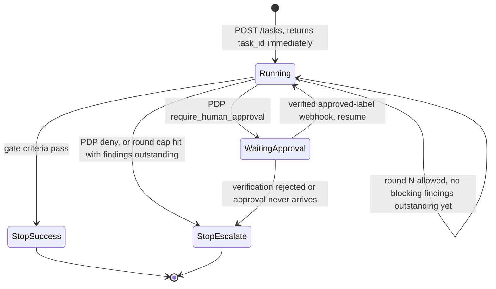

# Follow-up Design: Full-Pipeline Execution, Async Task State, and Real Human Approval

| | |
|---|---|
| **Status** | Draft — not implemented. Staged in `docs/designs/next/` pending review; move to `docs/designs/` (and update [`orchestrator-design.md`](../orchestrator-design.md)) once adopted |
| **Date** | 2026-09-11 |
| **Owner** | kniemiec |
| **Builds on** | [ADR-7](../../architecture/week1-adr-7-multi-agent-review-workflow.md) (core loop, generate/fan-out/aggregate/evaluate), [ADR-9](../../architecture/week2-adr-9-orchestrator-foundations.md) §B (human-approval mechanism) |
| **Extends** | The implemented MVP described in [`orchestrator-design.md`](../orchestrator-design.md) |

## 1. Problem statement

The implemented MVP (Phases 0–6) proves the *mechanics* of ADR-7's core loop — round cap, concurrent fan-out, blocking-vs-advisory aggregation, hash-chained audit — but simplifies away three things ADR-7/ADR-9 actually specify, and a real "configure the whole pipeline once, run it to completion, pause only for human approval" workflow needs all three:

1. **No "generate" (coding-agent) stage.** ADR-7's round is *generate → fan out → aggregate → evaluate*; the MVP's round is *fan out → aggregate → evaluate* — there's nothing that writes or fixes code, so a round that finds a blocking issue has no way to act on it before the next round asks the same question again.
2. **No real human-approval pause/resume.** ADR-9 §B specifies: open an issue, wait for a verified `approved` label, then continue. The MVP's `NoopApprovalVerifier` always returns `Approved: false`, and `coreloop.Run` checks it exactly once, synchronously, then terminates — there is no "wait" at all.
3. **`control-plane` is fully synchronous.** One HTTP request runs a task to a terminal state and returns. There is structurally nowhere for "pause for a human, possibly hours later, then resume" to live in that model — approval-gating is impossible to build correctly without first making task execution asynchronous and resumable.

None of this conflicts with ADR-7/ADR-9 — it's exactly what those ADRs already describe. This document designs the gap between "documented" and "built."

## 2. Goals / non-goals

**Goals**
- Configure a full stage pipeline once (coding → test → review → [merge]); trigger it once; it runs unattended to `stop-success`/`stop-escalate`, pausing only where policy requires a human.
- A real, ADR-9-§B-shaped approval mechanism: issue-based, webhook-verified, resumable.
- Survive a `control-plane` restart while a task is paused on approval — no in-memory-only wait state.
- Stay proportionate: no new infrastructure beyond what's already decided (Forgejo, Postgres) — the same discipline ADR-9 itself insisted on when rejecting OPAL/etcd/a dedicated approval UI.

**Non-goals (for this document)**
- Horizontal control-plane scaling / a real job queue. A single-process, Postgres-backed resume model is proportionate to the current solo-pilot scale (ADR-9's own stated scope).
- Auto-merge. See §4.6 — deliberately left as an open decision, not assumed.
- Crash recovery for a task actively mid-round (not paused). Out of scope here; today's synchronous design has the same gap.

## 3. Design overview



The core structural change: **task execution moves from "one blocking function call" to "a persisted state machine, stepped round-by-round, that can suspend and be resumed by an external event."** Everything else in this document follows from that.

## 4. Detailed design

### 4.1 The generate stage

**Contract change**: add an optional `phase` field to `schemas/stages.schema.json` and the `ResolvedStep` wire shape (`api/openapi/pdp-authzen.yaml`, `internal/clients/policyclient.ResolvedStep`):

```yaml
- id: implement
  type: agent-stage          # stays within ADR-11's fixed step-type closed set
  phase: generate            # new — default "review" if omitted (today's behavior)
  bot_account: coding-agent
  task_type: pr-review-round
  blocking: true
```

- `phase: generate` — runs **first each round, sequentially, alone** (not in the fan-out set). At most one resolved step may have `phase: generate` per round; `coreloop.Run` treats a second one as a fail-closed configuration error (deny-shaped, not a panic).
- `phase: review` (default) — today's behavior: every such resolved step fans out concurrently, as now.
- This is deliberately an **orchestration-order** field, not a new step type — it does not touch ADR-11's "agent-stage | deterministic-step" closed set.

**`coreloop.Run` change**: split `decision.ResolvedSteps` into `generateStep` (0 or 1) and `reviewSteps` ([]). If `generateStep` is present, dispatch it through the *same* `StepExecutor`/`ContainerLauncher` mechanism as any agent-stage step, but synchronously and before fan-out; only proceed to fan-out if it succeeds. Its `LaunchRequest.Env` additionally carries `PRIOR_FINDINGS_JSON` — the previous round's aggregated `structured_result`s — so a real coding agent (or, in this repo's mocked world, a new launcher-mock fixture) has something to act on. Round 1 has no prior findings; the field is omitted.

**Fixture-side (mocked world)**: a new `launcher-mock` fixture, e.g. `implement-fix`, that — given `PRIOR_FINDINGS_JSON` is non-empty — commits a change addressing it (mirroring `review-with-commit`'s pattern: unique per-invocation path, `Invocation-Id:` trailer) and, given it's empty (round 1), commits an initial implementation instead.

### 4.2 Persisted, resumable task state

**Wire up the reserved `orchestrator` schema** ([`002_orchestrator_schema.sql`](../../../deploy/migrations/002_orchestrator_schema.sql)) instead of adding a parallel table — it was reserved for exactly this in Phase 5.

Extend `orchestrator.tasks` with the columns a resumable state machine needs:

```sql
ALTER TABLE orchestrator.tasks
    ADD COLUMN status text NOT NULL DEFAULT 'running',
        -- running | waiting_approval | stop_success | stop_escalate
    ADD COLUMN current_round integer NOT NULL DEFAULT 0,
    ADD COLUMN approval_issue_number integer,
    ADD COLUMN prior_findings jsonb,
    ADD COLUMN reason text,
    ADD COLUMN updated_at timestamptz NOT NULL DEFAULT now();
```

`orchestrator.step_runs` (already reserved) starts actually being written to — one row per `domain.StepRun`, giving `GET /tasks/{id}` (§4.3) and the next round's `generate` stage something durable to read `prior_findings` from, instead of only living in one in-memory `Result`.

**`internal/taskrunner` (new package)** owns the state machine `coreloop` currently owns outright:
- `taskrunner.Start(ctx, task) (taskID, error)` — inserts the `tasks` row, kicks off round 1 in a goroutine, returns immediately.
- `taskrunner.runRound(ctx, taskID)` — loads persisted state, runs exactly **one** round of `coreloop`'s generate → fan-out → aggregate → evaluate, then either: persists `current_round++` and calls itself again (allow, no blocking findings outstanding → loop or stop-success), persists `status = waiting_approval` and returns (require_human_approval, not yet approved), or persists a terminal status and returns.
- `taskrunner.Resume(ctx, taskID)` — called by the webhook handler (§4.4) after verification; loads persisted state and calls `runRound` again, this time with the approval already granted.

`coreloop` itself shrinks to a **pure, single-round function** (`RunRound(ctx, deps, task, round, priorFindings) (RoundResult, error)`) — testable exactly as today's unit tests already do, just called once per invocation instead of looping internally. `taskrunner` owns the looping, persistence, and pause/resume; `coreloop` still owns the ADR-7 decision logic.

### 4.3 Async API

`POST /tasks` becomes non-blocking:

```
POST /tasks  →  202 Accepted
{ "task_id": "task-...", "status": "running" }
```

New:

```
GET /tasks/{id}  →  200 OK
{
  "task_id": "task-...", "status": "waiting_approval",
  "current_round": 2, "pr_number": 7,
  "approval_issue_number": 12,
  "step_runs": [ ... ]   // as today's synchronous response shape
}
```

This is the status endpoint flagged as missing in the current design doc — it falls out of §4.2's persistence for free, rather than needing its own bespoke storage.

**Migration note**: today's synchronous `200 OK` with the full result in-body is a breaking change for existing callers (including `internal/e2e`'s smoke tests, which currently assert on the synchronous body). §8 sequences this so the async API lands with the e2e suite updated to poll in the same change.

### 4.4 Real `ApprovalVerifier` — ADR-9 §B

Two new pieces, both already-decided shapes per ADR-9 — no new mechanism invented here:

**A. `GitHostClient` gains two methods** (or, per the `internal/clients/gitclient` pattern established for `cmd/seed`, provisioning-adjacent methods on the concrete `*Client` if they're not needed by every caller): `CreateOrReuseIssue(ctx, repo, title, body) (Issue, error)` and `ListIssueLabels(ctx, repo, issueNumber) ([]string, error)`. Both map directly onto `code.gitea.io/sdk/gitea` calls, same pattern as every existing `GitHostClient` method.

**B. `POST /webhooks/forgejo`** — new endpoint on `control-plane`:
1. Verify `X-Forgejo-Signature` (HMAC-SHA256) against a configured per-repo (or, for the pilot, one global) webhook secret. Bad signature → `403`, nothing else happens. This is the same fail-closed posture as PDP-unreachable.
2. Parse the label-added event; extract repo + issue number + labeling user.
3. Look up `orchestrator.tasks WHERE approval_issue_number = ? AND status = 'waiting_approval'`. No match → `200` (not this orchestrator's concern), nothing else happens.
4. **Independently** call `GitHostClient.VerifyCollaboratorRole(ctx, repo, labelingUser, RoleWrite)` — do not trust the webhook payload's claim about the labeler's permissions, per ADR-9 §B and this repo's existing "never trust the thing being audited" pattern (ADR-1).
5. Both checks pass and the label is `approved` → persist `approved_by`, `approval_evidence` (issue URL + label event + verification timestamp — extends the same audit record fields ADR-9 §B specifies) onto the *next* `pdp-decision` audit row when the task resumes; flip `tasks.status` back to `running`; dispatch `taskrunner.Resume(ctx, taskID)` in a new goroutine (so the webhook response to Forgejo returns fast, per webhook best practice — don't make Forgejo wait on a full round of execution).
6. Verification failure at any step → **do nothing except log** (fail-closed: the task stays `waiting_approval`, exactly ADR-9 §B's "verification failure is treated as not approved," not a false negative that surfaces as `stop-escalate`).

**Why this needs no reconciliation/recovery job**: because resume is *triggered by the webhook arriving*, not by a poller, a `control-plane` restart while tasks are `waiting_approval` loses nothing — the state is durable in Postgres, and whenever the (possibly-delayed, possibly-redelivered) webhook eventually arrives, step 3's lookup still finds the task and resumes it correctly.

**`ApprovalVerifier`'s real implementation** becomes almost trivial given the above split: `VerifyApproval` just reads whether `tasks.approved_by` is set for this task — the heavy lifting (signature verification, collaborator-role check) already happened once, in the webhook handler, not synchronously inside the round loop. `NoopApprovalVerifier` remains as the fake/fail-closed default for anything not wired to real Forgejo webhooks (e.g. local dev without webhook delivery configured).

**Sequence for one paused-then-resumed task:**

```mermaid
sequenceDiagram
    participant TR as taskrunner
    participant PDP as pdp-mock / PDP
    participant FJ as Forgejo
    participant H as Human approver
    participant WH as control-plane<br/>POST /webhooks/forgejo

    TR->>PDP: Evaluate(task, round)
    PDP-->>TR: require_human_approval
    TR->>FJ: CreateOrReuseIssue(task spec)
    FJ-->>TR: issue #12
    TR->>TR: persist status=waiting_approval,<br/>approval_issue_number=12
    Note over TR: goroutine returns — nothing blocked, nothing polling

    H->>FJ: adds "approved" label to issue #12
    FJ->>WH: webhook: label added (HMAC-signed)
    WH->>WH: verify signature
    WH->>FJ: VerifyCollaboratorRole(labeler, RoleWrite)
    FJ-->>WH: confirmed
    WH->>WH: persist approved_by, approval_evidence;<br/>status=running
    WH->>TR: Resume(task_id) — new goroutine
    TR->>PDP: Evaluate(task, round) — re-check, same round
    PDP-->>TR: allow (or require_human_approval again, now satisfied)
    Note over TR: continues fan-out as normal
```

### 4.5 What stays exactly as-is

- `internal/executor` (`AgentStageExecutor`/`DeterministicStepExecutor`), `internal/clients/*` production implementations, the mTLS launcher channel, per-step credential mint/revoke, the hash-chained audit writer, and the aggregate/evaluate blocking-vs-advisory logic are all untouched by this design — it only changes *what drives `coreloop`* and *what happens between rounds*, not the round's own internals.
- Existing unit tests for `coreloop` continue to work with light adaptation (calling `RunRound` once instead of `Run` in a loop, per §4.2).

### 4.6 Open decision: is "merge" an automated stage?

ADR-7's success path is explicitly "notify the human that the PR is ready for approval" — merging is a human action, not an orchestrator stage, by design (a deliberate control point, not an oversight the ADR left unaddressed). This document does **not** assume auto-merge. If wanted, the smallest addition consistent with everything above would be a policy-gated deterministic-step-shaped stage (e.g. `id: merge, type: deterministic-step`) that only PDP resolves for tasks under some `auto_merge: true` policy flag, running after `stop-success` — but this is a genuinely new decision beyond what any current ADR states, not an implementation gap like §4.1–§4.4. Recommend resolving it explicitly (a short ADR addendum or amendment) before building it, rather than deciding it implicitly in code.

## 5. Data model changes (summary)

| Table | Change |
|---|---|
| `orchestrator.tasks` | New columns: `status`, `current_round`, `approval_issue_number`, `prior_findings`, `reason`, `updated_at` (see §4.2) |
| `orchestrator.step_runs` | Starts being written to (already reserved, unchanged shape) |
| `audit.invocation_audit` | Unchanged shape; `approved`/`approved_by`/`evidence` fields (already present, currently always empty) start being populated for real on resume |

## 6. API contract changes (summary)

| Endpoint | Change |
|---|---|
| `POST /tasks` | `200` synchronous body → `202` + `task_id`, execution continues in background |
| `GET /tasks/{id}` | **New** — status polling, backed by `orchestrator.tasks`/`step_runs` |
| `POST /webhooks/forgejo` | **New** — HMAC-verified label-event receiver, drives resume |

## 7. Security considerations

- Webhook signature verification is fail-closed by construction (§4.4 step 1/6) — this is the same posture as PDP-unreachable and matches ADR-9 §B exactly.
- The webhook secret is a new credential this design introduces — store it the same way `deploy/.env` already stores other local-dev secrets (gitignored), and treat it as sensitive as `FORGEJO_ADMIN_TOKEN` in any real deployment.
- Independent collaborator-role re-verification (not trusting the webhook payload) closes the same class of gap ADR-2/ADR-3 already insist on elsewhere in this project — don't skip it as a "just trust the webhook" shortcut even though it's tempting for a solo pilot.
- `prior_findings` fed into the `generate` stage's env is, per ADR-0's existing tool-output-is-untrusted-content principle, still untrusted content from the orchestrator's own mocked/real review stages — the coding-agent prompt framing built on top of it (out of scope here, an ADR-8 runtime-selection concern) should treat it accordingly, not as a trusted instruction.

## 8. Suggested implementation sequence

Structured so each phase is independently shippable and testable — pick up as many as you want in one pass:

1. **Generate stage** (§4.1) — smallest, fully additive, no API/persistence changes. Add the `phase` field, split dispatch in `coreloop`, add the `implement-fix` fixture. Testable with today's synchronous API unchanged.
2. **Persisted task state + `taskrunner`** (§4.2) — wire up the reserved schema, extract `taskrunner`, keep the API synchronous for now (the HTTP handler just calls `taskrunner.Start` then blocks on a completion channel — same external behavior, new internals). This phase is the re-plumbing; it's the highest-risk/most-mechanical one and worth doing in isolation before behavior changes on top of it.
3. **Async API** (§4.3) — flip `POST /tasks` to `202`, add `GET /tasks/{id}`. Update `internal/e2e` to poll.
4. **Real `ApprovalVerifier` + webhook** (§4.4) — the actual pause/resume behavior; depends on 2 and 3 both being in place.

## 9. Testing strategy for this design

- **Unit**: `taskrunner`'s pause/resume transitions against fakes (no real Forgejo/Postgres) — mirrors the existing `internal/coreloop` fake-based test style.
- **Integration**: webhook signature verification (valid/invalid HMAC), collaborator-role re-verification (approved-by-non-collaborator must fail closed) — same pattern as the existing mTLS-rejection and Postgres-role-privilege tests.
- **E2E**: extend `internal/e2e` with a scenario that POSTs a task, polls until `waiting_approval`, simulates a signed label webhook, and asserts it resumes to `stop-success` — the natural next entry in the same suite that already proves baseline-policy merging and round-cap escalation.

## 10. Open questions

- Exact approver-set definition (a Forgejo team vs. minimum collaborator role) — ADR-9 itself left this open; needs pinning down here too, since §4.4 step 4 needs a concrete threshold.
- Webhook secret provisioning: one global secret (simplest, matches this pilot's single-repo-pair scale today) vs. genuinely per-repo (matches ADR-9's stated design, matters once there's more than the two seeded repos).
- Whether `GET /tasks/{id}` needs auth/access control once this stops being a single-operator local pilot — not a concern at current scale, flagged for later.
- §4.6's auto-merge question — explicitly unresolved, see §4.6.
