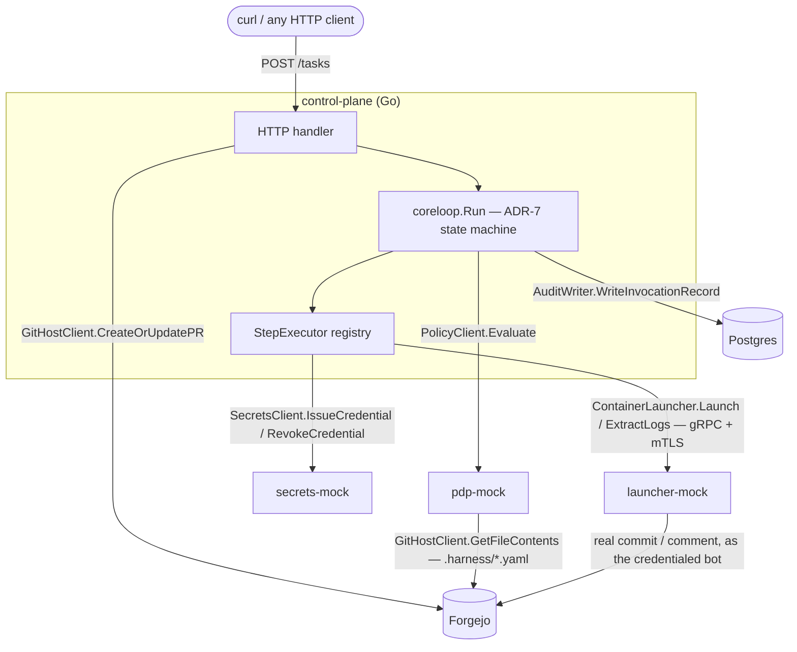
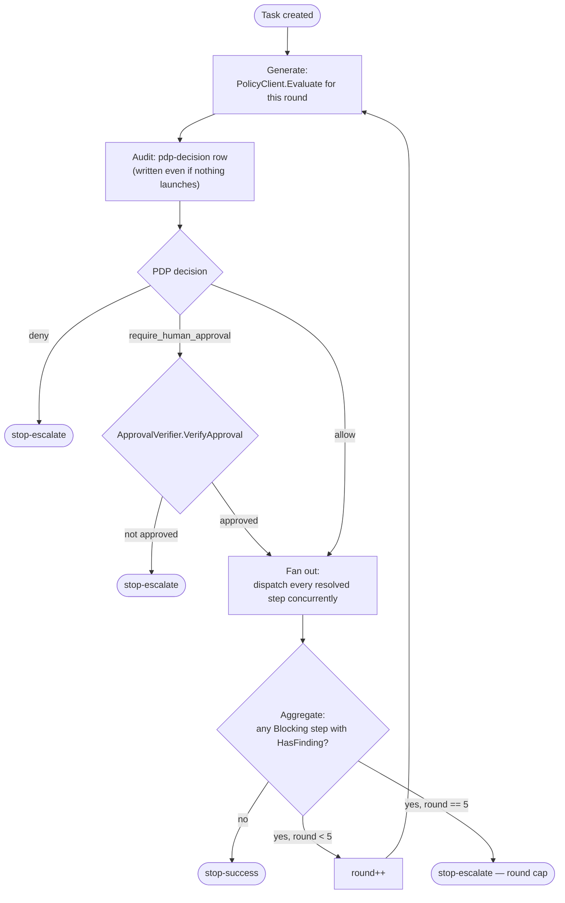
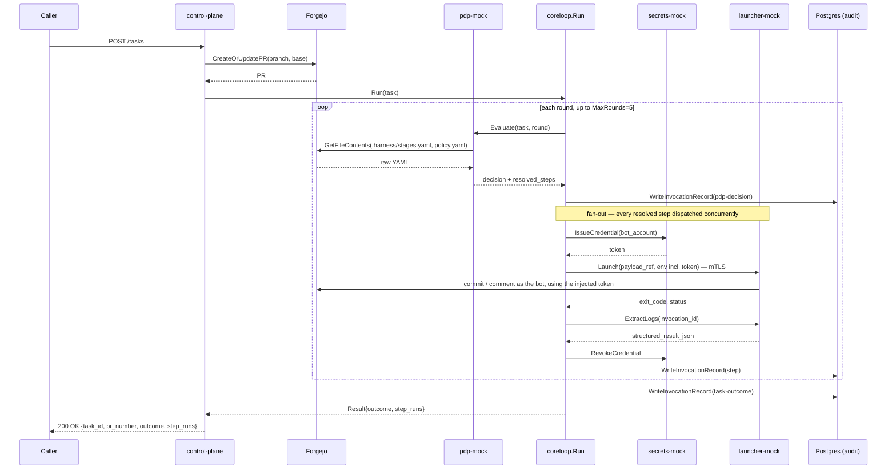
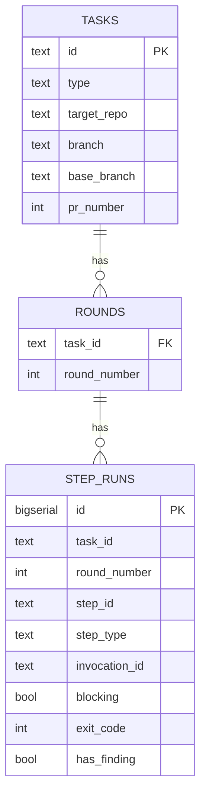
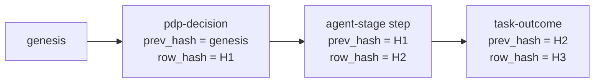

# Orchestrator Control-Plane — Technical Design & Runbook

| | |
|---|---|
| **Status** | Implemented (Phases 0–6 of the build plan) |
| **Date** | 2026-09-11 |
| **Owner** | kniemiec |
| **Scope** | The Go orchestrator control-plane in this repo: what it is, how its pieces fit together, and how to run and test it locally |
| **Related** | [ADR-7](../architecture/week1-adr-7-multi-agent-review-workflow.md) (core loop), [ADR-9](../architecture/week2-adr-9-orchestrator-foundations.md) (foundations), [ADR-11](../architecture/week3-adr-11-orchestrator-execution-engine.md) (execution engine), [build plan](../plans/active/orchestrator-control-plane-mvp.md) |

## 1. Overview

The orchestrator is a control-plane that runs a fixed review/automation loop against a Git repo: given a task (a branch to review, test, or triage), it repeatedly asks a policy engine what to do, dispatches the resulting steps to a launcher, and stops when the result is clean or a round cap is hit. Every decision is written to an append-only, hash-chained audit trail.

This build proves the design end-to-end against **real Forgejo and real Postgres**, with the **policy engine, secrets service, and sandboxed launcher mocked** as their own services implementing the same contracts a real deployment would use. Swapping a mock for its real counterpart (e.g. the real Firecracker/jailer launcher from [the microVM PoC](../plans/firecracker-microvm-launch-poc.md)) means implementing the same interface — no orchestrator code changes.

## 2. Architecture

### 2.1 Components

| Component | Role | Real or mocked |
|---|---|---|
| `cmd/control-plane` | The orchestrator itself: REST API, `coreloop` state machine, `StepExecutor` dispatch | Real |
| `cmd/pdp-mock` | Policy Decision Point — AuthZEN-shaped HTTP service | Mocked, but computes real decisions by reading live repo config |
| `cmd/secrets-mock` | Credential issuance — static pre-provisioned bot-token pool | Mocked |
| `cmd/launcher-mock` | Executes steps — gRPC + mTLS service, fixture-driven | Mocked, but performs real Forgejo side effects |
| `cmd/seed` | One-shot CLI: provisions bot accounts and the two config repos | Real (one-shot tool, not a running service) |
| Forgejo | Git host | Real (`codeberg.org/forgejo/forgejo:16`) |
| Postgres | `orchestrator` schema (reserved) + `audit` schema (live) | Real (`postgres:16-alpine`) |

### 2.2 Component diagram



Every arrow out of `control-plane` is one of [ADR-9](../architecture/week2-adr-9-orchestrator-foundations.md)'s six named test-seam interfaces — `GitHostClient`, `PolicyClient`, `SecretsClient`, `ContainerLauncher`, `AuditWriter`, `ApprovalVerifier` (the sixth, not pictured, is a fail-closed stub — see [§7](#7-security-model)). Each has exactly one production implementation in `internal/clients/*` (or `internal/audit` / `internal/approval`), and one in-memory fake in `internal/fakes` used only by unit tests.

## 3. Core loop (ADR-7 state machine)

`internal/coreloop.Run` implements ADR-7's fixed loop for one task: **generate → fan out → aggregate → evaluate → continue / stop-success / stop-escalate**, capped at `MaxRounds = 5`.



Key rules:
- **PDP-deny and unapproved `require_human_approval` short-circuit before any launch** — zero steps run, but the round's PDP decision is still audited.
- **Fan-out is genuinely concurrent** (`internal/coreloop/coreloop_test.go` proves this structurally: a test deadlocks, not just times out slowly, if fan-out ever becomes sequential).
- **Aggregation is blocking-vs-advisory**: a step only gates continuation if its resolved `blocking: true` *and* it reported a finding. A non-blocking (advisory) finding never stops the loop from reaching `stop-success`.
- **The round cap is a hard stop**, not a policy decision — if blocking findings persist through round 5, the task always escalates.

## 4. Request lifecycle



The credential minted for a step is scoped to **the bot account PDP resolved that step to run as**, not the orchestrator's own identity — `launcher-mock`'s fixtures authenticate to Forgejo with that exact token, so commits and comments are genuinely attributed to `review-bot` / `ci-bot`, not to the control-plane's admin credential.

## 5. Contracts

Every orchestrator ↔ external-service boundary is a versioned artifact, reviewable independently of its implementation:

| Contract | File(s) | Consumer(s) |
|---|---|---|
| `ContainerLauncher` (gRPC) | `api/proto/launcher/v1/launcher.proto` → generated into `api/gen/go/launcher/v1/` via `make proto-gen` (buf) | `internal/clients/launcherclient`, `cmd/launcher-mock` |
| `PolicyClient` (AuthZEN + `resolved_steps` extension) | `api/openapi/pdp-authzen.yaml` | `internal/clients/policyclient`, `cmd/pdp-mock` |
| `SecretsClient` (OpenBao-shaped subset) | `api/openapi/secrets.yaml` | `internal/clients/secretsclient`, `cmd/secrets-mock` |
| `.harness/stages.yaml` shape | `schemas/stages.schema.json` (+ `schemas/fixtures/stages.*.json`) | `internal/config`, `cmd/pdp-mock` |
| `.harness/policy.yaml` shape | `schemas/policy.schema.json` (+ `schemas/fixtures/policy.*.json`) | `internal/config`, `cmd/pdp-mock` |
| `GitHostClient` | Go interface only, `internal/clients/gitclient/gitclient.go` (no separate spec — it wraps `code.gitea.io/sdk/gitea`, which is Forgejo's own contract) | `cmd/control-plane`, `cmd/pdp-mock`, `cmd/launcher-mock` |

The six ADR-9 interfaces and where their real/fake implementations live:

| Interface | Production impl | Fake (unit tests) |
|---|---|---|
| `GitHostClient` | `internal/clients/gitclient.Client` | `internal/fakes.FakeGitHostClient` |
| `PolicyClient` | `internal/clients/policyclient.Client` | `internal/fakes.FakePolicyClient` |
| `SecretsClient` | `internal/clients/secretsclient.Client` | `internal/fakes.FakeSecretsClient` |
| `ContainerLauncher` | `internal/clients/launcherclient.Client` | `internal/fakes.FakeContainerLauncher` |
| `AuditWriter` | `internal/audit.PostgresWriter` | `internal/fakes.FakeAuditWriter` (real hash-chain semantics, no DB) |
| `ApprovalVerifier` | `internal/approval.NoopApprovalVerifier` (fail-closed stub — the real Forgejo issue/label/webhook flow is out of scope) | `internal/fakes.FakeApprovalVerifier` |

`internal/clients/gitclient` also exposes provisioning-only methods (`CreateRepo`, `CreateFile`, `EnsureUser`, `MintAccessToken`, `AddCollaborator`) on the concrete `*Client`, deliberately **not** part of the `GitHostClient` interface — they're for `cmd/seed`'s one-time bootstrapping and `launcher-mock`'s commit-with-trailer fixture, not the orchestrator's own runtime.

## 6. Data model

### 6.1 `orchestrator` schema — reserved, not yet wired

`deploy/migrations/002_orchestrator_schema.sql` creates the live-state tables the plan names, with full CRUD granted to role `orchestrator_app`. **Nothing in this codebase writes to them yet** — `coreloop` currently runs statelessly per request. This is deliberate: no ADR-9 interface asks for a state-persistence layer, so building one would be scope not actually requested.



### 6.2 `audit` schema — the live hash-chained trail

`deploy/migrations/003_audit_schema.sql` creates `audit.invocation_audit`, one row per invocation, merging the PDP decision, execution outcome, and approval fields onto a single hash-chained record:

| Column | Notes |
|---|---|
| `invocation_id` | Unique. One of: `<task>:round-N:pdp-eval`, `<task>:<round>:<step_id>`, or `<task>:outcome` |
| `task_id`, `round` | Correlates rows for the reconciliation check (§7) |
| `step_type` | `pdp-decision` \| `agent-stage` \| `deterministic-step` \| `task-outcome` |
| `policy_decision`, `granted_scopes`, `policy_bundle_version`, `resolved_steps` | PDP decision fields (`pdp-decision` rows only) |
| `exit_code`, `status` | Execution outcome (step and task-outcome rows) |
| `approved`, `approved_by`, `evidence` | Approval fields (currently always `false`/empty — `NoopApprovalVerifier`) |
| `prev_hash`, `row_hash` | SHA-256 hash chain, see below |

Role `orchestrator_audit_writer` is granted **`SELECT` + `INSERT` only — never `UPDATE`/`DELETE`** (verified by a literal Postgres-role privilege test). `SELECT` is required because extending the chain means reading the previous row, and `GetTaskChain` is itself a read — "INSERT-only" is interpreted as "append-only, no mutation," not "write-only."



`row_hash = SHA-256(canonical JSON of the row's content ‖ prev_hash)`. `internal/audit.VerifyChain` recomputes every row's hash and checks each `prev_hash` against the previous row's `row_hash`, returning a descriptive error naming the first broken link. Per-task-id writes are serialized with a Postgres advisory lock (`pg_advisory_xact_lock(hashtext(task_id))`) so concurrent fan-out writes for the same task still extend one valid chain.

## 7. Security model

- **mTLS on the launcher channel.** `deploy/gen-certs.sh` generates a local dev CA plus a server cert (`launcher-mock`) and client cert (`control-plane`); the gRPC server requires and verifies the client cert (`tls.RequireAndVerifyClientCert`). Enforcement is verified live (a connection without a client cert fails at the TLS handshake, not the app layer).
- **Per-step scoped credentials, not one shared token.** Every step mints its own credential (`SecretsClient.IssueCredential`, scoped to the bot account PDP resolved) before launch and revokes it after — regardless of success or failure.
- **Fail-closed policy posture.** PDP errors, denies, and unapproved `require_human_approval` all resolve to `stop-escalate`, never silently proceed. `NoopApprovalVerifier` always returns `Approved: false` — there is no code path that approves anything today.
- **Postgres privilege separation is a grant, not a convention** — see §6.2.
- **Policy-gate reconciliation.** An offline check (`internal/audit/reconciliation_integration_test.go`) proves the audit trail itself is consistent: for every `pdp-decision` row with `policy_decision = allow`, the number of step-level rows for that `(task_id, round)` equals `resolved_steps`'s length; for `deny`/unapproved rounds, it's always zero.

## 8. Directory structure

```
cmd/
  control-plane/   REST API + wiring — the real production binary
  pdp-mock/        AuthZEN-shaped PDP, reads .harness/*.yaml live from Forgejo
  secrets-mock/    static bot-token pool
  launcher-mock/   gRPC+mTLS, fixture-driven, real Forgejo side effects
  seed/            one-shot idempotent bootstrap CLI

internal/
  domain/           Task, Round, StepRun, Invocation
  coreloop/         ADR-7 state machine
  executor/         StepExecutor registry + AgentStageExecutor / DeterministicStepExecutor
  clients/
    gitclient/        GitHostClient (+ seed/launcher-mock-only provisioning methods)
    policyclient/     PolicyClient
    secretsclient/    SecretsClient
    launcherclient/   ContainerLauncher
  audit/            AuditWriter, hash chain, Postgres impl
  approval/         ApprovalVerifier (NoopApprovalVerifier)
  config/           .harness/*.yaml structs + JSON Schema validation
  fakes/            in-memory fakes, one per interface
  e2e/              the real end-to-end smoke test (build tag `e2e`)

api/
  proto/launcher/v1/launcher.proto
  openapi/{pdp-authzen,secrets}.yaml
  gen/go/launcher/v1/   generated gRPC stubs (buf)

schemas/            stages/policy JSON Schemas + fixtures
deploy/
  docker-compose.yml, docker/*.Dockerfile
  migrations/*.sql, migrate.sh
  bootstrap-admin.sh, gen-certs.sh
  .env.example
```

## 9. Running it locally

**Prerequisites**: Go toolchain, Docker + Docker Compose, `openssl` (cert generation).

```sh
# 1. One-time env file
cp deploy/.env.example deploy/.env
#    (edit passwords if you want; the defaults are fine for local dev)

# 2. Bring up Forgejo + Postgres + all three mocks + control-plane
make compose-up          # also generates dev mTLS certs (deploy/certs/)

# 3. Mint a Forgejo admin token (writes FORGEJO_ADMIN_TOKEN into deploy/.env,
#    and recreates pdp-mock/control-plane so they pick it up)
make bootstrap-admin

# 4. Apply the Postgres migrations (orchestrator + audit schemas/roles)
make migrate

# 5. Provision bot accounts + the global-baseline and sample-repo config repos
make seed
```

After step 5 you have a fully working stack: Forgejo at `http://localhost:3001` (admin login `forgejo-admin` / `changeme-local-only` — **not** `admin`, that username is reserved by Forgejo), and `control-plane` listening on `http://localhost:8080`.

To tear down: `make compose-down`. Re-running `make seed` at any time resets the two config repos and mints fresh bot tokens (idempotent — see §11).

### Ports

| Service | Port | Notes |
|---|---|---|
| Forgejo (UI/API) | `3001` → container `3000` | Not `3000` — a different, unrelated Forgejo instance may already be using that port on your machine |
| Forgejo SSH | `2222` |  |
| Postgres | `5432` |  |
| `secrets-mock` | `8082` |  |
| `pdp-mock` | `8081` |  |
| `launcher-mock` | `9443` | mTLS only |
| `control-plane` | `8080` |  |

## 10. Using the orchestrator

The one REST endpoint:

```sh
curl -s -X POST http://localhost:8080/tasks \
  -H "Content-Type: application/json" \
  -d '{
    "target_repo": "forgejo-admin/sample-repo",
    "branch": "feature-branch",
    "base_branch": "main",
    "task_type": "pr-review-round",
    "risk_tier": "low",
    "triggering_principal": "manual-test",
    "bot_account": "requesting-account",
    "pr_title": "Manual test PR",
    "pr_body": "Testing the orchestrator"
  }' | python3 -m json.tool
```

Response shape:

```json
{
  "task_id": "task-...",
  "pr_number": 1,
  "outcome": "stop-success",
  "rounds_run": 1,
  "reason": "",
  "step_runs": [
    {
      "round": 1, "step_id": "review-with-commit", "step_type": "agent-stage",
      "invocation_id": "...", "blocking": true, "exit_code": 0,
      "has_finding": false, "structured_result": {"has_blocking_finding": false}
    }
  ]
}
```

Other scenarios against the same seeded repo:
- `"risk_tier": "high"` → the global-baseline policy repo requires human approval at that tier; the task escalates immediately with zero launches (proves baseline-policy merging is live, not just present in code).
- Request POSTed twice against the same branch → `CreateOrUpdatePR` finds and updates the existing PR rather than duplicating it.

Verify the real side effects directly against Forgejo:

```sh
set -a; . deploy/.env; set +a
curl -s -H "Authorization: token $FORGEJO_ADMIN_TOKEN" \
  "$FORGEJO_URL/api/v1/repos/forgejo-admin/sample-repo/issues/1/comments"
```

Or the audit trail directly against Postgres:

```sh
docker compose -f deploy/docker-compose.yml exec -T postgres \
  env PGPASSWORD=orchestrator_audit_writer \
  psql -U orchestrator_audit_writer -d orchestrator -c \
  "SELECT invocation_id, step_type, policy_decision, status FROM audit.invocation_audit WHERE task_id = 'task-...' ORDER BY id;"
```

## 11. Testing

| Layer | Needs live services? | Command | What it proves |
|---|---|---|---|
| Unit | No | `go test ./...` (or `go test -race ./...`) | `coreloop`/`executor` logic against fakes; hash-chain math; JSON Schema fixtures; OpenAPI well-formedness |
| Integration | Yes — `compose-up` + `bootstrap-admin` + `migrate` | `make test-integration` | Each production client against its real counterpart (real Forgejo, real Postgres, the three mocks) — incl. the mTLS enforcement check, the Postgres-role privilege test, and the tamper-detection test |
| Spike | Yes — `compose-up` + `bootstrap-admin` | `make test-spike` | The `code.gitea.io/sdk/gitea` SDK actually covers `GitHostClient`'s surface (Phase 0 spike, kept as a regression check) |
| E2E smoke | Yes — full stack + `make seed` | `make test-e2e` | The real system, driven through its real HTTP API: a task produces a real PR with a trailer-bearing commit, a real review comment, a structured deterministic-step result, a ≥3-row valid audit chain, and `stop-success`; a second scenario proves baseline-policy merging; a third forces the round cap to `stop-escalate` |

The e2e suite is verified **reproducible**: it passes on repeated runs against the same seeded state, and again after a fresh `make seed`. (`internal/e2e/smoke_test.go`'s own history is a good example of why this matters — a fixture bug that only broke on the *second* run of the same test was caught exactly by checking this.)

```sh
go test ./...                 # unit — fast, no services
make test-integration         # integration — needs compose-up/bootstrap-admin/migrate
make test-spike                # SDK coverage spike
make test-e2e                  # full e2e — needs compose-up/bootstrap-admin/migrate/seed
```

## 12. Troubleshooting

- **"Forgejo admin login doesn't work."** Check you're on **`:3001`**, not `:3000` — a leftover, unrelated Forgejo container from earlier PoC work may be squatting on the default port. `docker ps --format '{{.Names}}: {{.Ports}}'` will show both if so.
- **`pdp-mock` / `control-plane` crash-looping with "required env var FORGEJO_TOKEN is not set."** Expected on a first-ever `compose-up`, before `make bootstrap-admin` has minted a token — `bootstrap-admin.sh` recreates both containers once the token exists. If you see this after that, check `deploy/.env` actually has `FORGEJO_ADMIN_TOKEN` set.
- **A schema/column-type migration you just applied doesn't seem to take effect.** Postgres client connections (including `control-plane`'s pool) can cache prepared-statement type metadata from before a `DROP`/`ALTER`. Restart the affected container (`docker compose ... restart control-plane`) after a schema change that alters a column type.
- **`make seed` fails with a password/auth error for a bot account.** If a bot account already exists with a different password than `cmd/seed` expects (e.g. created manually), `EnsureUser` deletes and recreates it — this is expected and safe for these throwaway local accounts.

## 13. Known limitations / out of scope

Carried over from the build plan, still true:
- No real `ContainerLauncher`/jailer/Firecracker implementation — `launcher-mock`'s slot is ready for it behind the same gRPC+mTLS contract.
- No real OPA policy engine or webhook-triggered bundle build — `pdp-mock` reads live YAML instead.
- No real per-invocation secrets minting — `secrets-mock`'s pool is static.
- No real human-approval flow (Forgejo issue/label/webhook-HMAC) — `NoopApprovalVerifier` always denies.
- `orchestrator` schema (tasks/rounds/step_runs) exists but nothing writes to it — `coreloop` is stateless per request.
- No horizontal control-plane scaling, no UI, no Prometheus/Alertmanager wiring.

## 14. Reference

### Environment variables by service

| Service | Required | Optional |
|---|---|---|
| `control-plane` | `FORGEJO_URL`, `FORGEJO_TOKEN`, `PDP_MOCK_URL`, `SECRETS_MOCK_URL`, `LAUNCHER_ADDR`, `TLS_CA_CERT`, `TLS_CLIENT_CERT`, `TLS_CLIENT_KEY`, `AUDIT_DB_DSN` | `ADDR` (default `:8080`), `ORCHESTRATOR_INSTANCE_ID` |
| `pdp-mock` | `FORGEJO_URL`, `FORGEJO_TOKEN` | `ADDR`, `PDP_MOCK_REF` (default `main`), `GLOBAL_BASELINE_REPO` |
| `secrets-mock` | — | `ADDR`, `SECRETS_MOCK_POOL_JSON` |
| `launcher-mock` | `TLS_CA_CERT`, `TLS_SERVER_CERT`, `TLS_SERVER_KEY` | `ADDR` |
| `cmd/seed` | `FORGEJO_URL`, `FORGEJO_ADMIN_TOKEN`, `FORGEJO_ADMIN_USERNAME` | `SEED_ENV_FILE` (default `deploy/.env`) |

Full local-dev defaults for all of these live in `deploy/.env.example`.

### Makefile targets

`build`, `test`, `test-spike`, `test-integration`, `test-e2e`, `gen-certs`, `compose-up`, `compose-down`, `compose-logs`, `bootstrap-admin`, `migrate`, `seed`, `tidy`, `install-buf`, `proto-lint`, `proto-gen`.
